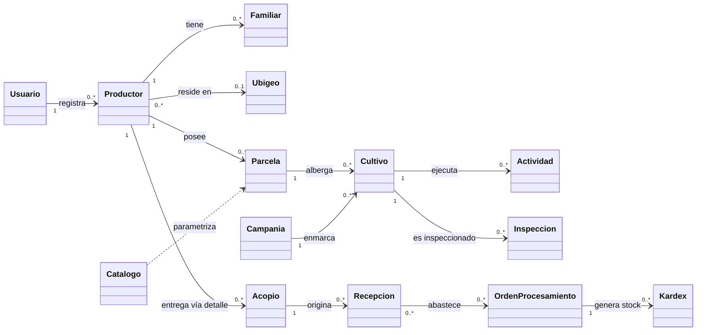
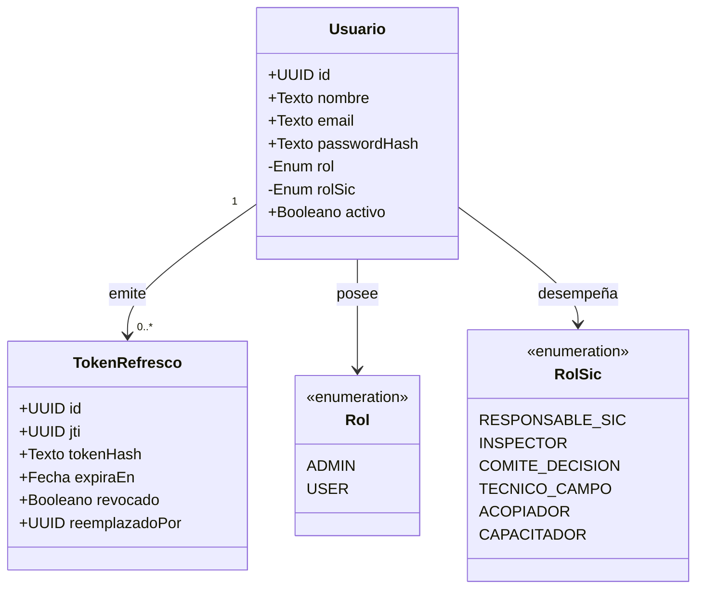
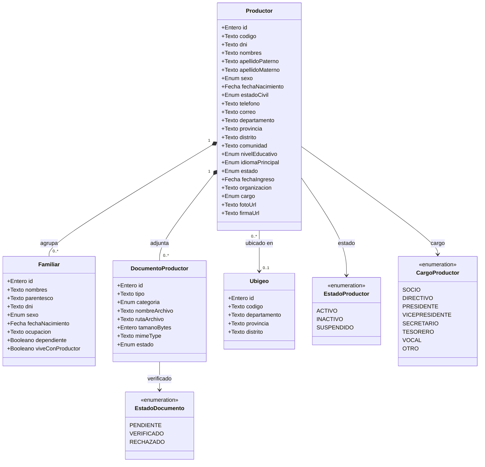
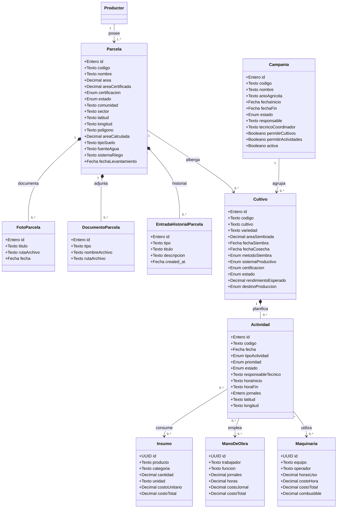
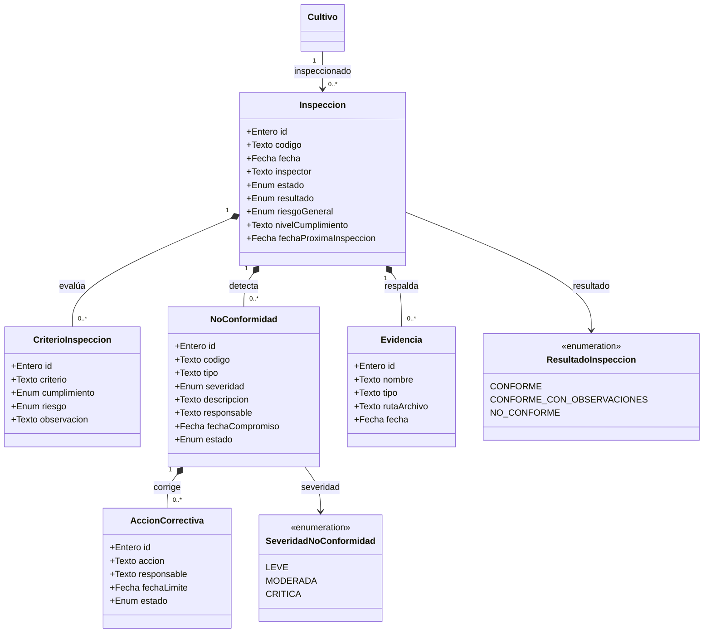
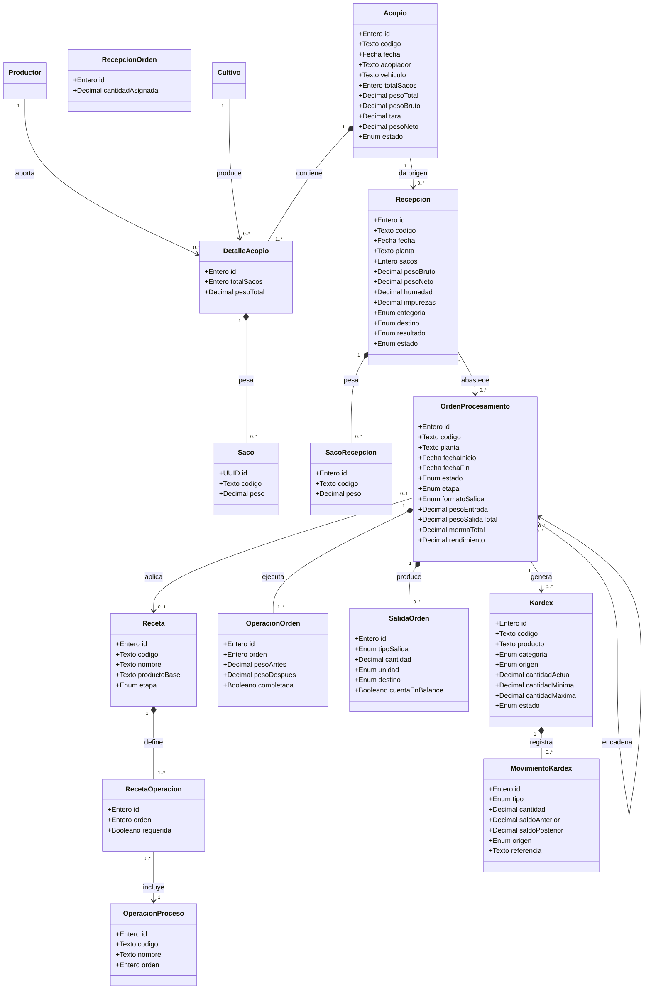
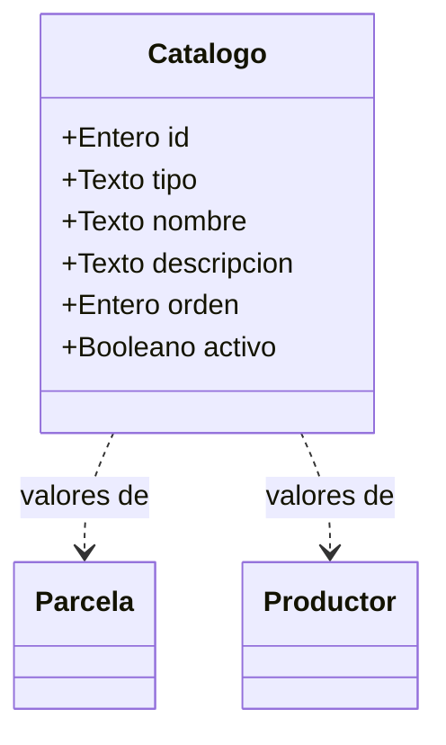

# AgroData Móvil — Modelo de Dominio (ICONIX · Parte 1)

> **Metodología:** ICONIX (Rosenberg & Stephens) — UML minimalista, dirigido por casos de uso.
> **Alcance de la documentación:** aplicación móvil (`apps/mobile`), que consume el mismo
> dominio del API (`apps/api`) y la misma base de datos (`packages/database`).
> **Fuente de verdad:** `packages/database/prisma/schema.prisma`.
> **Nota:** `docs/SYSTEM.md` está desactualizado (menciona `lotes`, `inventario` y
> `trazabilidad`, que ya no existen). Este documento refleja el esquema vigente.

---

## 1. Objetivo del Modelo de Dominio

Primer artefacto de ICONIX. Describe **las clases del negocio** (conceptos del mundo
real que el sistema debe recordar), sus **atributos relevantes** y sus **asociaciones
con multiplicidades**. No incluye operaciones ni detalles de implementación: eso se
resuelve en el Diagrama de Clases (Parte 5).

El modelo se organiza en **seis módulos del dominio** que coinciden con los paquetes de
funcionalidad del móvil:

| Módulo | Contexto | Entidades principales |
|---|---|---|
| **Seguridad** | Identidad y acceso | `Usuario`, `TokenRefresco` |
| **Socios** | Registro de productores y su entorno familiar | `Productor`, `Familiar`, `DocumentoProductor`, `Ubigeo` |
| **Campo** | Ciclo productivo agrícola | `Parcela`, `Campania`, `Cultivo`, `Actividad`, `Insumo`, `ManoDeObra`, `Maquinaria` |
| **Calidad** | Inspecciones SIC | `Inspeccion`, `CriterioInspeccion`, `NoConformidad`, `AccionCorrectiva`, `Evidencia` |
| **Operaciones** | Acopio → Recepción → Procesamiento → Kardex | `Acopio`, `DetalleAcopio`, `Saco`, `Recepcion`, `OrdenProcesamiento`, `Receta`, `OperacionProceso`, `Kardex`, `MovimientoKardex` |
| **Administración** | Catálogos del sistema | `Catalogo` |

---

## 2. Convenciones del modelo

- **Nombres de clase:** PascalCase en español (ej. `Productor`, `OrdenProcesamiento`).
- **Tipos de atributo:** tipos de negocio (`Texto`, `Entero`, `Decimal`, `Fecha`, `Booleano`,
  `Enum`, `UUID`). Entre paréntesis se indica el nombre real del campo en el esquema.
- **Multiplicidad:** notación UML (`1`, `0..1`, `0..*`, `1..*`).
- **Solo se listan atributos con significado de negocio.** Los campos de auditoría
  (`created_at`, `updated_at`, `created_by`, `updated_by`, `activo`) son comunes a casi
  todas las entidades y se omiten del catálogo por brevedad, salvo cuando aportan regla
  de negocio (por ejemplo `activo` para borrado lógico).
- Los nombres de las tablas del esquema que **no** coinciden con la clase se anotan entre
  paréntesis angulares: `Productor <usuarios/prod>`.

---

## 3. Diagrama general del dominio (contexto)

> Las dependencias hacia `Catalogo` son **parametrizaciones** (listas de valores
> configurables por tipo), no composiciones.

---

## 4. Módulo: Seguridad (Identidad y acceso)

### 4.1 Diagrama

### 4.2 Catálogo

| Clase | Tabla | Atributos de negocio | Reglas / invariantes |
|---|---|---|---|
| `Usuario` | `usuarios` | `nombre`, `email` (único), `password` (hash), `rol`, `rol_sic`, `activo` | El email es único. `rol` distingue administrador de usuario operativo. `rol_sic` especializa el rol dentro del Sistema Interno de Control (SIC). |
| `TokenRefresco` | `refresh_tokens` | `jti` (único), `user_id`, `token_hash`, `expires_at`, `revoked`, `replaced_by` | Rotación: cada uso revoca el token anterior y lo enlaza con `replaced_by`. |

> `TokenRefresco` es una clase de **soporte técnico** derivada de la decisión de
> seguridad (JWT con rotación). Se mantiene en el modelo para trazabilidad de la
> autenticación, aunque no proviene directamente del negocio.

---

## 5. Módulo: Socios (Productores y entorno familiar)

### 5.1 Diagrama

### 5.2 Catálogo

| Clase | Tabla | Atributos clave | Reglas / invariantes |
|---|---|---|---|
| `Productor` | `Productor` | `codigo` (único), `dni` (único), datos personales, ubicación (`departamento/provincia/distrito/comunidad`), `nivel_educativo`, `idioma_principal`, `estado`, `fecha_ingreso`, `organizacion`, `cargo`, `foto_url`, `firma_url` | `codigo` y `dni` únicos. Un productor pertenece a **una** organización y tiene **un** cargo. Estado por defecto `ACTIVO`. |
| `Familiar` | `familiar` | `nombres`, `parentesco`, `dni`, `sexo`, `fecha_nacimiento`, `ocupacion`, `dependiente`, `vive_con_productor` | Pertenece a **un** productor (composición). `dni` opcional. |
| `DocumentoProductor` | `documentos` | `tipo`, `categoria`, `nombre_archivo`, `ruta_archivo`, `tamano_bytes`, `mime_type`, `estado` | Cada documento se asocia a un productor y se clasifica por categoría (`PERSONAL`, `INSTITUCIONAL`, `OTROS`). |
| `Ubigeo` | `ubigeo` | `ubigeo` (6 dígitos, único), `dpto`, `prov`, `distrito` | Catálogo geográfico oficial. Productor y Parcela lo referencian de forma opcional. |

---

## 6. Módulo: Campo (Ciclo productivo)

### 6.1 Diagrama

### 6.2 Catálogo

| Clase | Tabla | Atributos clave | Reglas / invariantes |
|---|---|---|---|
| `Parcela` | `parcela` | `codigo` (único), `nombre`, `area`, `area_certificada`, `certificacion`, `estado`, ubicación, coordenadas GPS (`latitud/longitud`), `poligono`, `area_calculada`, `tipo_suelo`, `fuente_agua`, `sistema_riego` | Toda parcela pertenece a **un** productor. La geometría (`poligono`, `vertices`, `perimetro`) permite calcular el área. Estado `ACTIVA`/`INACTIVA`. |
| `FotoParcela` / `DocumentoParcela` / `EntradaHistorialParcela` | `parcela_fotos`, `parcela_documentos`, `parcela_historial` | Metadatos del archivo / evento | Composición de la parcela. `EntradaHistorialParcela` funciona como **bitácora** de cambios. |
| `Campania` | `campanias` | `codigo` (único), `nombre`, `anio_agricola`, `fecha_inicio/fin`, `estado`, `responsable`, `tecnico_coordinador`, flags `permitir_*`, `activa` | Solo **una** campaña puede estar `activa` a la vez (regla de negocio). Los flags `permitir_*` habilitan/deshabilitan módulos (cultivos, actividades, cosechas, inspecciones, acopio, procesamiento) dentro de la campaña. |
| `Cultivo` | `cultivo` | `codigo` (único), `cultivo`, `variedad`, `area_sembrada`, `fecha_siembra`, `fecha_cosecha`, `metodo_siembra`, `sistema_productivo`, `certificacion`, `estado`, `rendimiento_esperado`, `destino_produccion` | Un cultivo siempre pertenece a **una** parcela y a **una** campaña. Estado en `EN_CRECIMIENTO`/`COSECHADO`/`PERDIDO`. |
| `Actividad` | `actividades` | `codigo` (único), `fecha`, `tipo_actividad` (17 tipos), `prioridad`, `estado`, `responsable_tecnico`, `hora_inicio/fin`, `jornales`, coordenadas | Una actividad pertenece a **un** cultivo. Puede consumir varios insumos, mano de obra y maquinaria (relación N:M). |
| `Insumo`, `ManoDeObra`, `Maquinaria` | `Insumo`, `Mano_de_obra`, `Maquinaria` | Descripción + costos | Catálogos operativos que se **asocian** a actividades. Persisten como entidades independientes (relación N:M mediante tablas puente). |

---

## 7. Módulo: Calidad (Inspecciones SIC)

### 7.1 Diagrama

### 7.2 Catálogo

| Clase | Tabla | Atributos clave | Reglas / invariantes |
|---|---|---|---|
| `Inspeccion` | `Inspecciones` | `codigo` (único), `fecha`, `inspector`, `estado`, `resultado`, `riesgo_general`, `nivel_cumplimiento`, `fecha_proxima_inspeccion` | Una inspección se realiza sobre **un** cultivo. El `resultado` se deriva del análisis del checklist y define el `estado` (`APROBADA`/`NO_CONFORME`). |
| `CriterioInspeccion` | `inspeccion_checklist` | `criterio`, `cumplimiento`, `riesgo`, `observacion` | Cada criterio se evalúa como `CUMPLE`/`NO_CUMPLE`/`NO_APLICA` con un nivel de riesgo. |
| `NoConformidad` | `No_conformidades` | `codigo`, `tipo`, `severidad`, `descripcion`, `responsable`, `fecha_compromiso`, `estado` | Se deriva de un criterio no conforme. Severidad `LEVE`/`MODERADA`/`CRITICA`. |
| `AccionCorrectiva` | `Acciones_correctivas` | `accion`, `responsable`, `fecha_limite`, `estado` | Cada no conformidad puede tener una o varias acciones correctivas con seguimiento de estado. |
| `Evidencia` | `Evidencia` | `nombre`, `tipo`, `ruta_archivo`, `fecha`, `responsable` | Respalda una inspección (fotos/documentos). |

---

## 8. Módulo: Operaciones (Acopio → Kardex)

### 8.1 Diagrama

### 8.2 Catálogo

| Clase | Tabla | Atributos clave | Reglas / invariantes |
|---|---|---|---|
| `Acopio` | `acopio` | `codigo` (único), `fecha`, `acopiador`, `vehiculo`, `total_sacos`, `peso_bruto`, `tara`, `peso_neto`, `estado` | Cabecera de la recolección en campo. Estado `EN_CAMPO`/`EN_TRANSITO`/`RECIBIDO`. `peso_neto = peso_bruto − tara`. |
| `DetalleAcopio` | `acopio_detalle` | `productor_id`, `cultivo_id`, `parcela_id`, `total_sacos`, `peso_total` | Cada línea vincula la entrega de **un** productor/cultivo/parcela a un acopio. |
| `Saco` | `Saco` | `codigo`, `peso` | Pesaje individual dentro de un detalle de acopio. |
| `Recepcion` | `recepcion` | `codigo` (único), `planta`, `sacos`, `peso_campo/bruto/neto`, `diferencia`, `merma`, `humedad`, `impurezas`, `categoria`, `destino`, `resultado`, `estado` | Control de calidad y pesaje en planta. Se puede vincular opcionalmente a un acopio. Estado `PENDIENTE_PESAJE` → `EN_CONTROL_CALIDAD` → `DISPONIBLE`/`RECHAZADA`. |
| `SacoRecepcion` | `recepcion_saco` | `codigo`, `peso` | Pesaje individual en planta (composición de recepción). |
| `OrdenProcesamiento` | `orden_procesamiento` | `codigo` (único), `planta`, `etapa`, `formato_salida`, `peso_entrada`, `peso_salida_total`, `merma_total`, `rendimiento`, `balance_ok` | Transformación del producto (lavado, despedrado, molienda, etc.). `etapa` ∈ {PRIMARIA, SECUNDARIA, EMPAQUE}. Se **encadena**: una orden puede originarse de otra (`orden_origen`). Debe cumplir **balance de masa** (`balance_ok`). |
| `Receta` / `RecetaOperacion` | `receta`, `receta_operacion` | `producto_base`, `etapa`, `formato_salida`; operaciones sugeridas | Plantilla de operaciones para un producto/etapa. Precarga el checklist de operaciones de una orden. |
| `OperacionProceso` | `operacion_proceso` | `codigo`, `nombre`, `orden` | Catálogo maestro de operaciones (lavado, despedrado, desaponificado, etc.). |
| `OperacionOrden` | `orden_operacion` | `orden`, `peso_antes`, `peso_despues`, `humedad`, `completada` | Operación efectivamente ejecutada dentro de una orden, con su `peso_antes/peso_despues`. |
| `SalidaOrden` | `orden_salida` | `tipo_salida`, `cantidad`, `unidad`, `destino`, `cuenta_en_balance` | Salidas pesadas (producto bueno, merma, piedras, saponina, envases). `cuenta_en_balance` decide si entra al balance de masa. |
| `RecepcionOrden` | `orden_recepcion` | `cantidad_asignada` | Asociación N:M entre orden y recepciones (una orden consume de varias). |
| `Kardex` | `kardex` | `codigo` (único), `producto`, `categoria`, `origen`, `cantidad_actual`, `cantidad_minima/maxima`, `estado`, `fecha_ingreso`, `fecha_vencimiento` | Inventario por producto. `cantidad_actual` se deriva de los movimientos. Alertas por mínimo/máximo. |
| `MovimientoKardex` | `kardex_movimiento` | `tipo`, `cantidad`, `saldo_anterior`, `saldo_posterior`, `origen`, `referencia`, `referencia_tipo`, `referencia_id` | Cada movimiento conserva el **saldo anterior y posterior** (invariante de integridad). Permite reconstruir el kardex (`recompute`). |

> **Clase heredada:** el esquema conserva la tabla `procesamiento` (modelo antiguo de
> procesamiento en un solo registro). El modelo vigente es `orden_procesamiento` con su
> rediseño (recetas, operaciones y salidas). Se recomienda **excluir** `procesamiento`
> del modelo de dominio y considerarlo legado.

---

## 9. Módulo: Administración (Catálogos)

### 9.1 Diagrama

### 9.2 Catálogo

| Clase | Tabla | Atributos clave | Reglas / invariantes |
|---|---|---|---|
| `Catalogo` | `catalogos` | `tipo`, `nombre`, `descripcion`, `orden`, `activo` | Listas configurables por `tipo` (ej. tipo de suelo, fuente de agua). La pareja `tipo + nombre` es única. |

---

## 10. Resumen de asociaciones y multiplicidades

| Origen | Destino | Multiplicidad | Tipo | Cardinalidad |
|---|---|---|---|---|
| Productor | Familiar | 1 → 0..* | Composición | 1:N |
| Productor | DocumentoProductor | 1 → 0..* | Composición | 1:N |
| Productor | Parcela | 1 → 1..* | Agregación | 1:N |
| Productor | Ubigeo | 0..* → 0..1 | Referencia | N:1 |
| Parcela | Cultivo | 1 → 0..* | Agregación | 1:N |
| Campania | Cultivo | 1 → 0..* | Agregación | 1:N |
| Cultivo | Actividad | 1 → 0..* | Composición | 1:N |
| Cultivo | Inspeccion | 1 → 0..* | Agregación | 1:N |
| Actividad | Insumo / ManoDeObra / Maquinaria | 0..* ↔ 0..* | Asociación | N:M |
| Inspeccion | CriterioInspeccion / NoConformidad / Evidencia | 1 → 0..* | Composición | 1:N |
| NoConformidad | AccionCorrectiva | 1 → 0..* | Composición | 1:N |
| Acopio | DetalleAcopio | 1 → 1..* | Composición | 1:N |
| DetalleAcopio | Saco | 1 → 0..* | Composición | 1:N |
| Productor | DetalleAcopio | 1 → 0..* | Asociación | 1:N |
| Acopio | Recepcion | 1 → 0..* | Asociación | 1:N |
| Recepcion | OrdenProcesamiento | 0..* ↔ 0..* | Asociación (N:M) | N:M |
| OrdenProcesamiento | Receta | 0..* → 0..1 | Referencia | N:1 |
| OrdenProcesamiento | OperacionOrden / SalidaOrden | 1 → 0..* | Composición | 1:N |
| OrdenProcesamiento | OrdenProcesamiento | 0..* → 0..1 | Auto-relación (encadenado) | N:1 |
| Receta | RecetaOperacion | 1 → 1..* | Composición | 1:N |
| OperacionProceso | RecetaOperacion / OperacionOrden | 1 → 0..* | Asociación | 1:N |
| OrdenProcesamiento | Kardex | 1 → 0..* | Asociación | 1:N |
| Kardex | MovimientoKardex | 1 → 0..* | Composición | 1:N |
| Usuario | TokenRefresco | 1 → 0..* | Composición | 1:N |
| Usuario | Productor | 1 → 0..* | Referencia (auditoría) | 1:N |

---

## 11. Clases excluidas del modelo de dominio

| Elemento | Motivo |
|---|---|
| `refresh_tokens` | Se incluye como `TokenRefresco` por trazabilidad de seguridad, pero es de soporte técnico. |
| `procesamiento` (modelo antiguo) | Reemplazado por `OrdenProcesamiento`. Legado. |
| Campos de auditoría (`created_at`, `updated_at`, `created_by`, `updated_by`) | Atributos técnicos comunes, no del negocio. |
| Tablas puente N:M (`Insumo_has_actividades`, `Mano_de_obra_has_actividades`, `Maquinaria_has_actividades`) | Se modelan como asociaciones, no como clases. |
| `ubigeo.sql` (data) | Poblado inicial, no estructura. |

---

## 12. Siguiente paso

**Parte 2 — Modelo de Casos de Uso:** identificar actores (ADMIN, USER y roles SIC) y
derivar los casos de uso a partir de las pantallas y endpoints del móvil, con su
descripción textual (flujo normal, alternos y precondiciones).

---

_Documento generado para la tesis. Requiere revisión del autor antes de continuar con la Parte 2._
