# AgroData Móvil — Modelo de Casos de Uso (ICONIX · Parte 2)

> **Metodología:** ICONIX — UML minimalista, dirigido por casos de uso.
> **Entrada:** Modelo de Dominio (Parte 1).
> **Alcance:** aplicación móvil (`apps/mobile`) y su consumo del API REST (`apps/api`).
> **Salida esperada:** catálogo de actores, mapa de casos de uso y descripción detallada
> de cada caso de uso (flujo normal, flujos alternos, reglas y trazabilidad).

Este documento es el **índice y marco común**. El detalle por módulo vive en:

| Archivo | Módulos |
|---|---|
| `02a-casos-seguridad-socios.md` | Seguridad (auth) y Socios (productores/familiares) |
| `02b-casos-campo.md` | Campo (campañas, parcelas, cultivos, actividades) |
| `02c-casos-calidad.md` | Calidad (inspecciones SIC) |
| `02d-casos-operaciones.md` | Operaciones (acopio, recepción, procesamiento, kardex) |
| `02e-casos-administracion.md` | Administración (usuarios, catálogos) y Dashboard |

---

## 1. Propósito y criterio ICONIX

En ICONIX los casos de uso son el **eje** del proceso: gobiernan el análisis de robustez
(Parte 3), los diagramas de secuencia (Parte 4) y el diagrama de clases (Parte 5). Por
eso cada caso de uso se documenta con la misma estructura y se traza a las clases del
Modelo de Dominio (Parte 1) y a las pantallas del móvil.

**Principio de buena forma:** un caso de uso = **un objetivo observable de valor para un
actor**. Se redacta en voz activa y en tiempo presente ("El usuario registra…").

---

## 2. Actores

La autenticación del API distingue dos roles (`Rol`): `ADMIN` y `USER`. Además el usuario
puede tener un **rol funcional del SIC** (`rol_sic`) que describe su función organizativa.

### 2.1 Actores primarios (humanos)

| Actor | Descripción | Permisos observados en el sistema |
|---|---|---|
| **Usuario** | Actor genérico autenticado. Base de los demás. | Autenticado: lectura de casi todos los módulos. |
| **Administrador** (`ADMIN`) | Usuario con privilegios de gestión. | Lectura + **escritura** (crear, editar, eliminar) en todos los módulos. |
| **Operador** (`USER`) | Usuario operativo sin privilegios de administrador. | **Solo lectura** en la mayoría de módulos; excepción: puede operar órdenes de procesamiento (ver §2.3). |

> **Regla de oro (verificada en `apps/api/src/middleware/auth.middleware.ts`):** todas las
> operaciones de escritura pasan por `adminMiddleware`, que devuelve **403** si el usuario
> no tiene `rol = ADMIN`. El móvil actual **no oculta** los botones según rol: muestra la
> UI de escritura y el error 403 si el usuario no es admin. Esto se registra como
> **deuda de diseño** a resolver (ver Parte 6, trazabilidad de requisitos).

### 2.2 Roles funcionales del SIC (`rol_sic`)

Se almacenan en el usuario, pero **el API aún no los usa como control de acceso**. Se
documentan como actores secundarios del negocio (aplica en trabajo futuro):

| Rol SIC | Función esperada |
|---|---|
| `RESPONSABLE_SIC` | Responsable del Sistema Interno de Control. |
| `INSPECTOR` | Realiza inspecciones de campo. |
| `COMITE_DECISION` | Evalúa resultados de inspecciones. |
| `TECNICO_CAMPO` | Ejecuta/registra actividades de campo. |
| `ACOPIADOR` | Realiza el acopio de producto. |
| `CAPACITADOR` | Capacita a los productores. |

### 2.3 Actores secundarios (sistemas)

| Actor | Rol en los casos de uso |
|---|---|
| **API REST AgroData** | Fuente de datos; valida (Joi) y persiste (Prisma/MySQL). |
| **Servicio de archivos** (`/api/upload/*`) | Almacena documentos, fotos y firmas. |
| **GPS del dispositivo** | Provee geolocalización de parcelas, actividades e inspecciones. |
| **Cámara del dispositivo** | Captura fotos y firmas digitales. |

---

## 3. Mapa de casos de uso

```mermaid
flowchart TB
    act(["👤 Usuario (ADMIN / USER)"])
    adm(["👤 Administrador"])
    sys["API AgroData"]

    subgraph SISTEMA["Sistema AgroData Móvil"]
        direction TB
        subgraph SEG["Seguridad"]
            UC01(["UC-01 Iniciar sesión"])
            UC02(["UC-02 Renovar sesión"])
            UC03(["UC-03 Cerrar sesión"])
            UC04(["UC-04 Ver perfil"])
            UC05(["UC-05 Cambiar contraseña"])
        end
        subgraph SOC["Socios"]
            UC06(["UC-06 Listar/buscar productores"])
            UC07(["UC-07 Ver detalle productor"])
            UC08(["UC-08 Registrar productor"])
            UC09(["UC-09 Editar productor"])
            UC10(["UC-10 Eliminar productor"])
            UC11(["UC-11 Gestionar familiares"])
        end
        subgraph CAM["Campo"]
            UC12(["UC-12 Gestionar campañas"])
            UC13(["UC-13 Gestionar parcelas"])
            UC14(["UC-14 Gestionar cultivos"])
            UC15(["UC-15 Gestionar actividades"])
        end
        subgraph CAL["Calidad"]
            UC16(["UC-16 Gestionar inspecciones"])
        end
        subgraph OPE["Operaciones"]
            UC17(["UC-17 Gestionar acopios"])
            UC18(["UC-18 Gestionar recepciones"])
            UC19(["UC-19 Gestionar órdenes de procesamiento"])
            UC20(["UC-20 Gestionar kardex"])
        end
        subgraph ADM["Administración"]
            UC21(["UC-21 Gestionar usuarios"])
            UC22(["UC-22 Gestionar catálogos"])
        end
        subgraph DASH["Panel"]
            UC23(["UC-23 Ver panel de control"])
        end
    end

    act --> UC01
    act --> UC02
    act --> UC03
    act --> UC04
    act --> UC05
    act --> UC06
    act --> UC07
    act --> UC23
    adm --> UC08
    adm --> UC09
    adm --> UC10
    adm --> UC11
    adm --> UC12
    adm --> UC13
    adm --> UC14
    adm --> UC15
    adm --> UC16
    adm --> UC17
    adm --> UC18
    adm --> UC20
    adm --> UC21
    adm --> UC22
    act --> UC19
    SISTEMA -.-> sys
```



> **Nota de notación:** Mermaid no tiene diagrama nativo de casos de uso; se emula con
> `flowchart` (actores = rectángulos; casos de uso = elipses/stadium; frontera = subgrafo
> "Sistema AgroData Móvil"). Es equivalente UML 2.

---

## 4. Resumen de casos de uso

| ID | Caso de uso | Actor(es) | Escritura | Módulo |
|---|---|:---:|:---:|---|
| UC-01 | Iniciar sesión | Usuario | — | Seguridad |
| UC-02 | Renovar sesión | Sistema/Usuario | — | Seguridad |
| UC-03 | Cerrar sesión | Usuario | — | Seguridad |
| UC-04 | Ver perfil | Usuario | — | Seguridad |
| UC-05 | Cambiar contraseña | Usuario | ✔ | Seguridad |
| UC-06 | Listar y buscar productores | Usuario | — | Socios |
| UC-07 | Ver detalle de productor | Usuario | — | Socios |
| UC-08 | Registrar productor | Administrador | ADMIN | Socios |
| UC-09 | Editar productor | Administrador | ADMIN | Socios |
| UC-10 | Eliminar productor | Administrador | ADMIN | Socios |
| UC-11 | Gestionar familiares | Administrador | ADMIN | Socios |
| UC-12 | Gestionar campañas | Usuario/Admin | ADMIN | Campo |
| UC-13 | Gestionar parcelas | Usuario/Admin | ADMIN | Campo |
| UC-14 | Gestionar cultivos | Usuario/Admin | ADMIN | Campo |
| UC-15 | Gestionar actividades | Usuario/Admin | ADMIN | Campo |
| UC-16 | Gestionar inspecciones | Usuario/Admin | ADMIN | Calidad |
| UC-17 | Gestionar acopios | Usuario/Admin | ADMIN | Operaciones |
| UC-18 | Gestionar recepciones | Usuario/Admin | ADMIN | Operaciones |
| UC-19 | Gestionar órdenes de procesamiento | Usuario | **libre** | Operaciones |
| UC-20 | Gestionar kardex | Usuario/Admin | ADMIN* | Operaciones |
| UC-21 | Gestionar usuarios | Administrador | ADMIN | Administración |
| UC-22 | Gestionar catálogos | Administrador | ADMIN | Administración |
| UC-23 | Ver panel de control | Usuario | — | Panel |

> `*` En kardex, `POST /salidas` y `POST /:id/baja` **no** exigen ADMIN (inconsistencia
> detectada). Se detalla en la Parte `02d`.

Cada caso de uso "gestionar" agrupa el CRUD y se desglosa en subcasos numerados
(`UC-13.1`, `UC-13.2`, …) dentro de cada archivo de módulo.

---

## 5. Plantilla de descripción de caso de uso

Cada caso de uso del móvil se documenta así (adaptación ICONIX al UML 2.5):

```
UC-XX  <Nombre>
───────────────────────────────────────────
Actor primario : <quién inicia>
Disparador     : <qué evento lo inicia>
Objetivo       : <beneficio/valor observable>
Precondiciones : <estado necesario>
Postcondiciones: <estado resultante (éxito)>
Entidades      : <clases del Modelo de Dominio (Parte 1)>
Pantallas      : <screens del móvil>
Endpoints      : <método + ruta del API>
Flujo normal   : 1..n pasos
Flujos alternos: A1, A2, … (varían el normal)
Excepciones    : E1, E2, … (fallan)
Reglas de negocio: RN-1, RN-2, …
Frecuencia     : alta / media / baja
```

---

## 6. Inventario de pantallas → casos de uso (trazabilidad UI)

| Pantalla móvil | Casos de uso |
|---|---|
| `LoginScreen` | UC-01 |
| `DashboardScreen` | UC-23 |
| `ProductoresScreen`, `ProductorDetailScreen`, `ProductorCreateScreen`, `ProductorEditScreen` | UC-06…UC-10 |
| `FamiliaresScreen`, `FamiliarCreateScreen`, `FamiliarEditScreen` | UC-11 |
| `CampaniasScreen`, `CampaniaDetailScreen`, `CampaniaFormScreen` | UC-12 |
| `ParcelasScreen`, `ParcelaDetailScreen`, `ParcelaFormScreen` | UC-13 |
| `CultivosScreen`, `CultivoDetailScreen`, `CultivoFormScreen` | UC-14 |
| `ActividadesScreen`, `ActividadDetailScreen`, `ActividadFormScreen` | UC-15 |
| `InspeccionesScreen`, `InspeccionDetailScreen`, `InspeccionFormScreen` | UC-16 |
| `AcopiosScreen`, `AcopioDetailScreen`, `AcopioFormScreen` | UC-17 |
| `RecepcionesScreen`, `RecepcionDetailScreen`, `RecepcionFormScreen` | UC-18 |
| `Procesamiento*Screen` (por cablear en navegación) | UC-19 |
| `KardexScreen`, `KardexDetailScreen`, `KardexFormScreen` | UC-20 |
| *(pendiente)* `Usuarios*Screen`, `CatalogoScreen` | UC-21, UC-22 |

---

## 7. Convenciones de redacción

- **Flujo normal:** pasos numerados, escritos como "El actor… / El sistema…".
- **Flujos alternos:** identificados `A1`, `A2`… y referenciados desde el paso del flujo
  normal donde se bifurcan.
- **Excepciones:** identificadas `E1`, `E2`… (errores que abortan el caso).
- **Reglas de negocio:** identificadas `RN-1`, `RN-2`… y referenciadas desde los pasos.
- Las validaciones provienen de los **validadores Joi** del API (fuente de verdad real).
