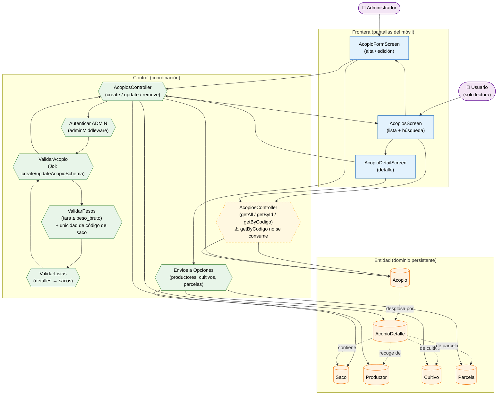

# Análisis de Robustez — Gestión de Acopios (ICONIX · Parte 3)

> **Misma convención:** 🟦 Frontera · 🟩 Control · 🟧 Entidad · 🟪 Actor secundario.

**Caso de uso cubierto:** UC-17 *Gestionar acopios* (17.1 listado/búsqueda, 17.2 detalle,
17.3 alta/edición con detalles y sacos, 17.4 baja).

---

## 1. Diagrama de robustez

---

## 2. Objetos identificados

### 2.1 Frontera

| Objeto | Pantalla real | Caso de uso |
|---|---|---|
| `AcopiosScreen` | `apps/mobile/src/screens/AcopiosScreen.tsx` | UC-17.1 |
| `AcopioFormScreen` | `AcopioFormScreen.tsx` (compartida alta/edición) | UC-17.3 |
| `AcopioDetailScreen` | `AcopioDetailScreen.tsx` | UC-17.2 / UC-17.4 |

### 2.2 Control

| Objeto | Implementación real | Responsabilidad |
|---|---|---|
| `AcopiosController` (lectura) | `apps/api/src/controllers/acopios.controller.ts` | `getAll`, `getById`, `getStats`, `getByCodigo` |
| `AcopiosController` (escritura) | mismo archivo | `create`, `update`, `remove` |
| `ValidarAcopio` | `apps/api/src/validators/acopios.validator.ts` | RN-1…RN-7 de UC-17.3 |
| `ValidarListas` | `acopioDetalleSchema`, `sacoSchema` | Cada detalle exige `productor_id`, `cultivo_id` y ≥1 saco |
| `ValidarPesos` | `.custom()` de `create/updateAcopioSchema` + `validateSacoUniqueness` | `tara ≤ peso_bruto` y unicidad del código de saco |
| `Autenticar ADMIN` | `auth.middleware.ts` (`adminMiddleware`) | Escritura solo `ADMIN` |
| `Envios a Opciones` | llamadas directas `api.get("/productores", "/cultivos", "/parcelas")` | Desplegables del formulario |

### 2.3 Entidad

| Objeto | Clase (Parte 1) | Persistencia |
|---|---|---|
| `Acopio` | `Acopio` | `acopios` |
| `AcopioDetalle` | `AcopioDetalle` | `acopio_detalles` |
| `Saco` | `Saco` | `acopio_sacos` |
| `Productor` | `Productor` | `productores` (FK obligatoria) |
| `Cultivo` | `Cultivo` | `cultivos` (FK obligatoria) |
| `Parcela` | `Parcela` | `parcelas_productor` (FK opcional) |

---

## 3. Trazabilidad flujo → objetos

| Paso (UC-17.3) | Frontera | Control | Entidad |
|---|---|---|---|
| Abrir lista de acopios | `AcopiosScreen` | `AcopiosController` (getAll) | `Acopio` |
| Buscar por `search` | `AcopiosScreen` | `getAllAcopiosSchema` | — |
| Pulsar "Nuevo acopio" | `AcopioFormScreen` | — | — |
| Cargar desplegables | `AcopioFormScreen` | `Envios a Opciones` | `Productor`, `Cultivo`, `Parcela` |
| Agregar **detalles** (productor + cultivo + parcela) | `AcopioFormScreen` | `ValidarListas` | `AcopioDetalle` |
| Agregar **sacos** por detalle | `AcopioFormScreen` | `ValidarListas` | `Saco` |
| Capturar `peso_bruto` y `tara` | `AcopioFormScreen` | `ValidarPesos` | `Acopio` (neto = bruto − tara) |
| Guardar | `AcopioFormScreen` | `AcopiosController` (create) | `Acopio` |
| Verificar permiso | — | `Autenticar ADMIN` | `Usuario` |
| Validar campos, listas y unicidad | — | `ValidarAcopio` / `ValidarPesos` | — |
| Ver detalle | `AcopioDetailScreen` | `AcopiosController` (getById) | `Acopio` |
| Eliminar acopio | `AcopioDetailScreen` | `AcopiosController` (remove) | `Acopio` |

---

## 4. Flujos alternos y excepciones

| Tipo | Condición | Reacción | Control |
|---|---|---|---|
| A1 | `codigo` vacío | Autogenerado por el backend | `AcopiosController` |
| A2 | Edición parcial (`PUT` con mínimo 1 campo); las listas **reemplazan** | Válido | `ValidarAcopio` |
| E1 | Sin detalles | 400 "Debe agregar al menos un productor" | `ValidarListas` |
| E2 | Detalle sin sacos | 400 "Debe agregar al menos un saco" | `ValidarListas` |
| E3 | **Código de saco duplicado** en todo el acopio | 400 "El código del saco X está duplicado" | `ValidarPesos` |
| E4 | `tara > peso_bruto` | 400 "La tara no puede ser mayor al peso bruto" | `ValidarPesos` |
| E5 | Falta `fecha` o `acopiador` | 400 | `ValidarAcopio` |
| E6 | Usuario no `ADMIN` en escritura | 403 | `Autenticar ADMIN` |

---

## 5. Hallazgos de la robustez

| # | Hallazgo | Impacto | Acción |
|---|---|---|---|
| R-1 | **No existe capa de servicio** (`acopios.ts`): las pantallas llaman `api.get/post/put/delete` **directamente** | Difiere del patrón de todos los demás módulos (que usan `*ToBackend`/`*ToFrontend`) | **Deuda** de arquitectura |
| R-2 | Anidamiento de **2 niveles**: `detalles[].sacos[]`, con validación **custom de unicidad** de código de saco | Complejidad comparable a inspecciones | Control `ValidarPesos` |
| R-3 | `create`/`update` usan **`PUT`** (≠ `PATCH` de campañas) | Contrato del API | Registrado |
| R-4 | El API ofrece `/stats` y `/buscar/:codigo`, pero el móvil **no los consume** | Sin KPIs ni búsqueda por código escaneado | **Deuda** — nodo punteado en el diagrama |
| R-5 | `RecepcionFormScreen` consulta `/acopios` para su desplegable | Uso transversal del recurso | Documentado |

> **Verificación ICONIX:** el flujo está completo; no hay objetos huérfanos. Se puede avanzar
> al **diagrama de secuencia** de este caso de uso.
