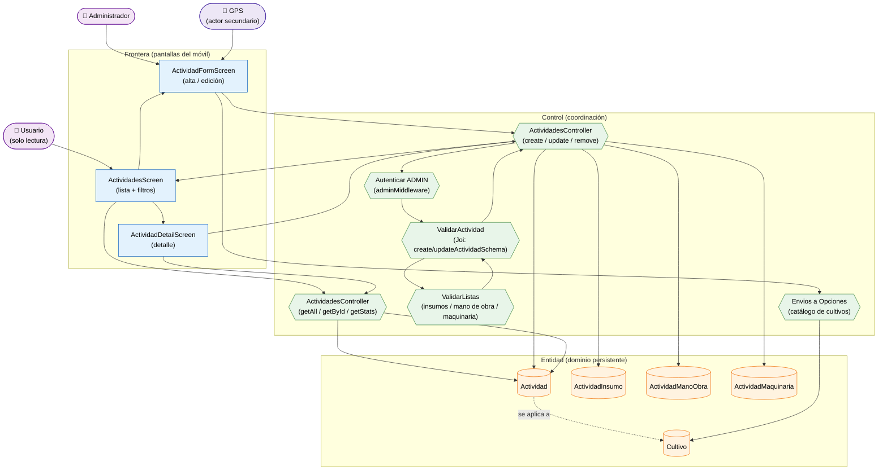

# Análisis de Robustez — Gestión de Actividades Agrícolas (ICONIX · Parte 3)

> **Misma convención:** 🟦 Frontera · 🟩 Control · 🟧 Entidad · 🟪 Actor secundario.

**Caso de uso cubierto:** UC-15 *Gestionar actividades* (15.1 listado/filtros, 15.2 detalle,
15.3 alta/edición con insumos, mano de obra y maquinaria, 15.4 baja).

---

## 1. Diagrama de robustez

---

## 2. Objetos identificados

### 2.1 Frontera

| Objeto | Pantalla real | Caso de uso |
|---|---|---|
| `ActividadesScreen` | `apps/mobile/src/screens/ActividadesScreen.tsx` | UC-15.1 |
| `ActividadFormScreen` | `ActividadFormScreen.tsx` (compartida alta/edición) | UC-15.3 |
| `ActividadDetailScreen` | `ActividadDetailScreen.tsx` | UC-15.2 / UC-15.4 |

### 2.2 Control

| Objeto | Implementación real | Responsabilidad |
|---|---|---|
| `ActividadesController` (lectura) | `apps/api/src/controllers/actividades.controller.ts` | `getAll`, `getById`, `getStats` |
| `ActividadesController` (escritura) | mismo archivo | `create`, `update`, `remove` |
| `ValidarActividad` | `apps/api/src/validators/actividades.validator.ts` | RN-1…RN-5 de UC-15.3 |
| `ValidarListas` | esquemas `insumoSchema`, `trabajadorSchema`, `maquinariaSchema` | Cada fila exige `producto` / `trabajador` / `equipo` |
| `Autenticar ADMIN` | `auth.middleware.ts` (`adminMiddleware`) | Escritura solo `ADMIN` |
| `Envios a Opciones` | `catalogos.ts` (`fetchCultivosOpciones`) | Desplegable de cultivos (FK obligatoria) |

### 2.3 Entidad

| Objeto | Clase (Parte 1) | Persistencia |
|---|---|---|
| `Actividad` | `Actividad` | `actividades` |
| `ActividadInsumo` | `ActividadInsumo` | `actividad_insumos` |
| `ActividadManoObra` | `ActividadManoObra` | `actividad_manobra` |
| `ActividadMaquinaria` | `ActividadMaquinaria` | `actividad_maquinaria` |
| `Cultivo` | `Cultivo` | `cultivos` (FK obligatoria) |

---

## 3. Trazabilidad flujo → objetos

| Paso (UC-15.3) | Frontera | Control | Entidad |
|---|---|---|---|
| Abrir lista de actividades | `ActividadesScreen` | `ActividadesController` (getAll) | `Actividad` |
| Filtrar (`search`, `estado`, `tipo_actividad`, `cultivo_id`) | `ActividadesScreen` | `getAllActividadesSchema` | — |
| Pulsar "Nueva actividad" | `ActividadFormScreen` | — | — |
| Seleccionar **cultivo** (FK) | `ActividadFormScreen` | `Envios a Opciones` | `Cultivo` |
| Capturar ubicación GPS | `ActividadFormScreen` | — | `Actividad` (lat/lng) |
| Agregar filas de **insumos** | `ActividadFormScreen` | `ValidarListas` | `ActividadInsumo` |
| Agregar filas de **mano de obra** | `ActividadFormScreen` | `ValidarListas` | `ActividadManoObra` |
| Agregar filas de **maquinaria** | `ActividadFormScreen` | `ValidarListas` | `ActividadMaquinaria` |
| Guardar | `ActividadFormScreen` | `ActividadesController` (create) | `Actividad` |
| Verificar permiso | — | `Autenticar ADMIN` | `Usuario` |
| Validar campos y enums | — | `ValidarActividad` | — |
| Ver detalle | `ActividadDetailScreen` | `ActividadesController` (getById) | `Actividad` |
| Eliminar actividad | `ActividadDetailScreen` | `ActividadesController` (remove) | `Actividad` |

---

## 4. Flujos alternos y excepciones

| Tipo | Condición | Reacción | Control |
|---|---|---|---|
| A1 | `codigo` vacío | Autogenerado por el backend | `ActividadesController` |
| A2 | Edición parcial (`PUT` con mínimo 1 campo) | Válido; las listas **reemplazan** las existentes | `ValidarActividad` |
| A3 | Actividad sin insumos/mano de obra/maquinaria | Válido (listas opcionales) | `ValidarListas` |
| E1 | Falta `cultivo_id`, `fecha`, `tipo_actividad` o `responsable_tecnico` | 400 | `ValidarActividad` |
| E2 | `hora_inicio`/`hora_fin` con formato ≠ `HH:MM` | 400 "Formato de hora inválido (HH:MM)" | `ValidarActividad` |
| E3 | Fila de insumo sin `producto`, mano de obra sin `trabajador` o maquinaria sin `equipo` | 400 | `ValidarListas` |
| E4 | Enum fuera de rango (`tipo_actividad`, `prioridad`, `estado`) | 400 | `ValidarActividad` |
| E5 | Usuario no `ADMIN` en escritura | 403 | `Autenticar ADMIN` |
| E6 | Fallo al cargar cultivos | El formulario permite reintentar | `Envios a Opciones` |

---

## 5. Hallazgos de la robustez

| # | Hallazgo | Impacto | Acción |
|---|---|---|---|
| R-1 | `create`/`update` usan **`PUT`** (≠ `PATCH` de campañas) | Contrato del API | Registrado |
| R-2 | Son **3 listas anidadas** (insumos, mano de obra, maquinaria), cada una con su mapper (`mapInsumosToBackend`, `mapManoObraToBackend`, `mapMaquinariaToBackend`) | El caso de uso es el más complejo del módulo Campo | Control `ValidarListas` separado |
| R-3 | Al editar, las listas **reemplazan** las existentes (no se difieren) | Dato crítico para el diagrama de secuencia | Documentado |
| R-4 | El formulario exige un **desplegable de cultivos** (FK obligatoria) | Control `Envios a Opciones` es crítico | Añadido |
| R-5 | El **GPS** aporta `latitud`, `longitud`, `altitud`, `precision_gps` como texto (no número) | Diferente a parcelas (donde son números validados por rango) | Registrado |
| R-6 | `SYSTEM.md` menciona `actividad_fotos`, pero **ni** el validador **ni** el servicio lo manejan | Sub-recurso inexistente en el flujo móvil | **Deuda** — no modelado |

> **Verificación ICONIX:** el flujo está completo; no hay objetos huérfanos. Se puede avanzar
> al **diagrama de secuencia** de este caso de uso.
