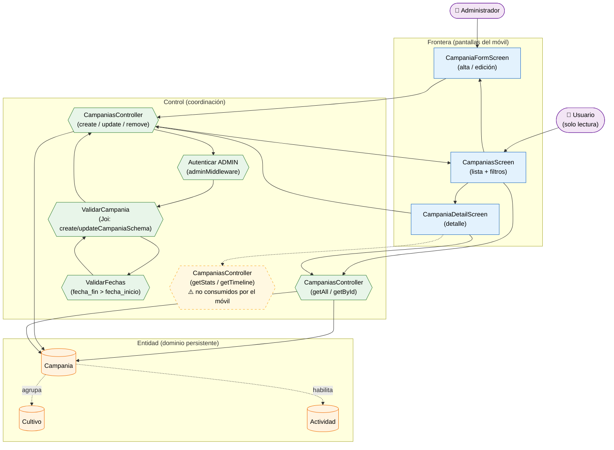

# Análisis de Robustez — Gestión de Campañas (ICONIX · Parte 3)

> **Misma convención** que los archivos previos: 🟦 Frontera (pantalla) · 🟩 Control ·
> 🟧 Entidad · 🟪 Actor secundario.

**Caso de uso cubierto:** UC-12 *Gestionar campañas* (12.1 listado/filtros, 12.2 detalle,
12.3 alta/edición, 12.4 baja).

---

## 1. Diagrama de robustez

---

## 2. Objetos identificados

### 2.1 Frontera

| Objeto | Pantalla real | Caso de uso |
|---|---|---|
| `CampaniasScreen` | `apps/mobile/src/screens/CampaniasScreen.tsx` | UC-12.1 |
| `CampaniaFormScreen` | `CampaniaFormScreen.tsx` (compartida alta/edición) | UC-12.3 |
| `CampaniaDetailScreen` | `CampaniaDetailScreen.tsx` | UC-12.2 / UC-12.4 |

### 2.2 Control

| Objeto | Implementación real | Responsabilidad |
|---|---|---|
| `CampaniasController` (lectura) | `apps/api/src/controllers/campanias.controller.ts` | `getAll`, `getById` |
| `CampaniasController` (escritura) | mismo archivo | `create`, `update`, `remove` |
| `ValidarCampania` | `apps/api/src/validators/campanias.validator.ts` | RN-1…RN-6 de UC-12.3 |
| `ValidarFechas` | `.custom()` de `updateCampaniaSchema` | `fecha_fin > fecha_inicio` |
| `Autenticar ADMIN` | `auth.middleware.ts` (`adminMiddleware`) | Escritura solo `ADMIN` |
| `getStats` / `getTimeline` | `campanias.controller.ts` | KPIs y línea de tiempo — **no llamados por el móvil** |

### 2.3 Entidad

| Objeto | Clase (Parte 1) | Persistencia |
|---|---|---|
| `Campania` | `Campania` | `campanias` |
| `Cultivo` | `Cultivo` | `cultivos` |
| `Actividad` | `Actividad` | `actividades` |

---

## 3. Trazabilidad flujo → objetos

| Paso (UC-12.3) | Frontera | Control | Entidad |
|---|---|---|---|
| Abrir lista de campañas | `CampaniasScreen` | `CampaniasController` (getAll) | `Campania` |
| Filtrar (`search`, `estado`, `anio_agricola`, `responsable`) | `CampaniasScreen` | `getAllCampaniasSchema` | — |
| Pulsar "Nueva campaña" | `CampaniaFormScreen` | — | — |
| Completar datos y guardar | `CampaniaFormScreen` | `CampaniasController` (create) | `Campania` |
| Verificar permiso | — | `Autenticar ADMIN` | `Usuario` |
| Validar campos | — | `ValidarCampania` | — |
| Validar orden de fechas | — | `ValidarFechas` | — |
| Ver detalle | `CampaniaDetailScreen` | `CampaniasController` (getById) | `Campania` |
| Eliminar campaña | `CampaniaDetailScreen` | `CampaniasController` (remove) | `Campania` |

---

## 4. Flujos alternos y excepciones

| Tipo | Condición | Reacción | Control |
|---|---|---|---|
| A1 | `codigo` vacío | Autogenerado por el backend | `CampaniasController` |
| A2 | Se edita solo un campo (`PATCH` parcial) | Válido (`min(1)`) | `ValidarCampania` |
| E1 | `anio_agricola` con formato distinto de `YYYY-YYYY` | 400 | `ValidarCampania` |
| E2 | `fecha_fin` ≤ `fecha_inicio` | 400 "La fecha de fin debe ser posterior a la de inicio" | `ValidarFechas` |
| E3 | Faltan `nombre`/`responsable`/`tecnico_coordinador`/`objetivo` | 400 | `ValidarCampania` |
| E4 | `estado` fuera del enum | 400 | `ValidarCampania` |
| E5 | Usuario no `ADMIN` en escritura | 403 | `Autenticar ADMIN` |

---

## 5. Hallazgos de la robustez

| # | Hallazgo | Impacto | Acción |
|---|---|---|---|
| R-1 | `update` usa **`PATCH`** (≠ `PUT` de parcelas/cultivos) | Contrato del API | Registrado |
| R-2 | La validación de fechas es **custom** (no solo Joi) | Control separado (`ValidarFechas`) | Añadido |
| R-3 | El modelo `Campania` del móvil **no expone** `permitir_*`, `activa` ni `visible` | Las banderas de RN-CAMPO-0 no son editables desde la app | **Deuda** — documentada |
| R-4 | El API ofrece `/stats`, `/:id/stats` y `/:id/timeline`, pero el móvil **no los consume** | El detalle no muestra KPIs ni línea de tiempo | **Deuda** — control marcado como pendiente en el diagrama |
| R-5 | No hay desplegables de catálogos: `estado` es un enum en el formulario | Sin control `Envios a Ubigeo/Catálogos` | Verificado |

> **Verificación ICONIX:** el flujo está completo. Los hallazgos R-3 y R-4 son **deuda
> funcional**, no errores de modelado; no impiden avanzar a la secuencia.
