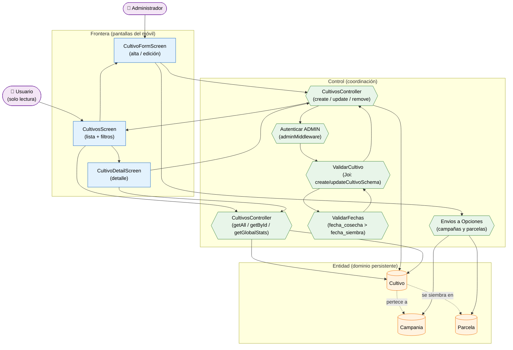

# Análisis de Robustez — Gestión de Cultivos (ICONIX · Parte 3)

> **Misma convención:** 🟦 Frontera · 🟩 Control · 🟧 Entidad · 🟪 Actor secundario.

**Caso de uso cubierto:** UC-14 *Gestionar cultivos* (14.1 listado/filtros, 14.2 detalle,
14.3 alta/edición, 14.4 baja).

---

## 1. Diagrama de robustez

---

## 2. Objetos identificados

### 2.1 Frontera

| Objeto | Pantalla real | Caso de uso |
|---|---|---|
| `CultivosScreen` | `apps/mobile/src/screens/CultivosScreen.tsx` | UC-14.1 |
| `CultivoFormScreen` | `CultivoFormScreen.tsx` (compartida alta/edición) | UC-14.3 |
| `CultivoDetailScreen` | `CultivoDetailScreen.tsx` | UC-14.2 / UC-14.4 |

### 2.2 Control

| Objeto | Implementación real | Responsabilidad |
|---|---|---|
| `CultivosController` (lectura) | `apps/api/src/controllers/cultivos.controller.ts` | `getAll`, `getById`, `getGlobalStats` |
| `CultivosController` (escritura) | mismo archivo | `create`, `update`, `remove` |
| `ValidarCultivo` | `apps/api/src/validators/cultivos.validator.ts` | RN-1…RN-7 de UC-14.3 |
| `ValidarFechas` | `.concat(fechaSiembraCosechaValidation)` | `fecha_cosecha > fecha_siembra` |
| `Autenticar ADMIN` | `auth.middleware.ts` (`adminMiddleware`) | Escritura solo `ADMIN` |
| `Envios a Opciones` | `catalogos.ts` (`fetchCampaniasOpciones`, `fetchParcelasOpciones`) | Desplegables obligatorios del formulario |

### 2.3 Entidad

| Objeto | Clase (Parte 1) | Persistencia |
|---|---|---|
| `Cultivo` | `Cultivo` | `cultivos` |
| `Campania` | `Campania` | `campanias` (FK obligatoria) |
| `Parcela` | `Parcela` | `parcelas_productor` (FK obligatoria) |

---

## 3. Trazabilidad flujo → objetos

| Paso (UC-14.3) | Frontera | Control | Entidad |
|---|---|---|---|
| Abrir lista de cultivos | `CultivosScreen` | `CultivosController` (getAll) | `Cultivo` |
| Filtrar (`search`, `estado`, `campania_id`, `parcela_id`) | `CultivosScreen` | `getAllCultivosSchema` | — |
| Pulsar "Nuevo cultivo" | `CultivoFormScreen` | — | — |
| Seleccionar **campaña** y **parcela** | `CultivoFormScreen` | `Envios a Opciones` | `Campania`, `Parcela` |
| Completar datos y guardar | `CultivoFormScreen` | `CultivosController` (create) | `Cultivo` |
| Verificar permiso | — | `Autenticar ADMIN` | `Usuario` |
| Validar campos y enums | — | `ValidarCultivo` | — |
| Validar orden de fechas | — | `ValidarFechas` | — |
| Ver detalle | `CultivoDetailScreen` | `CultivosController` (getById) | `Cultivo` |
| Eliminar cultivo | `CultivoDetailScreen` | `CultivosController` (remove) | `Cultivo` |

---

## 4. Flujos alternos y excepciones

| Tipo | Condición | Reacción | Control |
|---|---|---|---|
| A1 | `codigo` vacío | Autogenerado por el backend | `CultivosController` |
| A2 | Edición parcial (`PUT` con mínimo 1 campo) | Válido | `ValidarCultivo` |
| E1 | Falta `campania_id` o `parcela_id` | 400 "La campaña es obligatoria" / "La parcela es obligatoria" | `ValidarCultivo` |
| E2 | `fecha_cosecha` ≤ `fecha_siembra` | 400 "La fecha de cosecha debe ser posterior a la fecha de siembra" | `ValidarFechas` |
| E3 | `area_sembrada` no positiva | 400 | `ValidarCultivo` |
| E4 | Enum fuera de rango (`metodo_siembra`, `sistema_productivo`, `certificacion`, `estado`…) | 400 | `ValidarCultivo` |
| E5 | Usuario no `ADMIN` en escritura | 403 | `Autenticar ADMIN` |
| E6 | Fallo al cargar campañas/parcelas | El formulario permite reintentar | `Envios a Opciones` |

---

## 5. Hallazgos de la robustez

| # | Hallazgo | Impacto | Acción |
|---|---|---|---|
| R-1 | `create`/`update` usan **`PUT`** (≠ `PATCH` de campañas) | Contrato del API | Registrado |
| R-2 | La validación de fechas es **custom** (`concat` sobre el esquema) | Control separado (`ValidarFechas`) | Añadido |
| R-3 | El formulario **exige 2 desplegables** (campaña y parcela) que son FK obligatorias | Control `Envios a Opciones` es crítico | Añadido |
| R-4 | `Cultivo` trae relaciones anidadas (`parcela`→`productor`, `campania`) pero el formulario **solo envía IDs** | Mapeo `cultivoToBackend` filtra a `campania_id`/`parcela_id` | Documentado |
| R-5 | `getGlobalStats` **sí** se consume desde el móvil (`fetchCultivoStats`) | A diferencia de campañas (R-4 previo) | Verificado, sin deuda |

> **Verificación ICONIX:** el flujo está completo; no hay objetos huérfanos. Se puede avanzar
> al **diagrama de secuencia** de este caso de uso.
