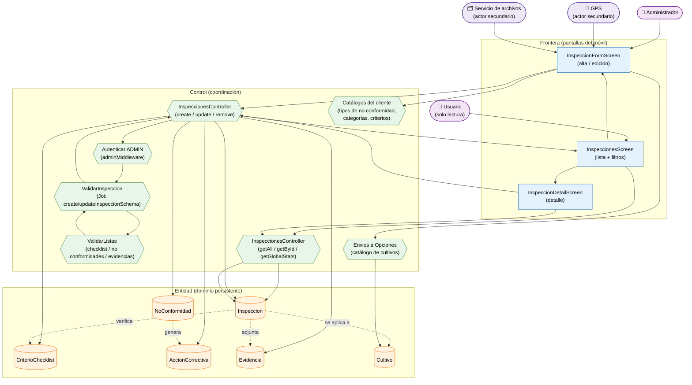

# Análisis de Robustez — Inspecciones Internas (SIC) (ICONIX · Parte 3)

> **Misma convención:** 🟦 Frontera · 🟩 Control · 🟧 Entidad · 🟪 Actor secundario.

**Caso de uso cubierto:** UC-16 *Gestionar inspecciones* (16.1 listado/filtros, 16.2 detalle,
16.3 alta/edición con checklist, no conformidades y evidencias, 16.4 baja).

---

## 1. Diagrama de robustez

---

## 2. Objetos identificados

### 2.1 Frontera

| Objeto | Pantalla real | Caso de uso |
|---|---|---|
| `InspeccionesScreen` | `apps/mobile/src/screens/InspeccionesScreen.tsx` | UC-16.1 |
| `InspeccionFormScreen` | `InspeccionFormScreen.tsx` (compartida alta/edición) | UC-16.3 |
| `InspeccionDetailScreen` | `InspeccionDetailScreen.tsx` | UC-16.2 / UC-16.4 |

### 2.2 Control

| Objeto | Implementación real | Responsabilidad |
|---|---|---|
| `InspeccionesController` (lectura) | `apps/api/src/controllers/inspecciones.controller.ts` | `getAll`, `getById`, `getGlobalStats` |
| `InspeccionesController` (escritura) | mismo archivo | `create`, `update`, `remove` |
| `ValidarInspeccion` | `apps/api/src/validators/inspecciones.validator.ts` | RN-1…RN-8 de UC-16.3 |
| `ValidarListas` | `checklistItemSchema`, `noConformidadSchema`, `accionCorrectivaSchema`, `evidenciaSchema` | Cada fila exige su campo obligatorio |
| `Autenticar ADMIN` | `auth.middleware.ts` (`adminMiddleware`) | Escritura solo `ADMIN` |
| `Envios a Opciones` | `catalogos.ts` (`fetchCultivosOpciones`) | Desplegable de cultivos (FK obligatoria) |
| `Catálogos del cliente` | `inspecciones.ts` (constantes `*Options`) | Tipos de no conformidad, categorías, criterios de checklist |

### 2.3 Entidad

| Objeto | Clase (Parte 1) | Persistencia |
|---|---|---|
| `Inspeccion` | `Inspeccion` | `inspecciones` |
| `CriterioChecklist` | `CriterioChecklist` | `inspeccion_checklist` |
| `NoConformidad` | `NoConformidad` | `inspeccion_no_conformidades` |
| `AccionCorrectiva` | `AccionCorrectiva` | `inspeccion_acciones_correctivas` |
| `Evidencia` | `Evidencia` | `inspeccion_evidencias` |
| `Cultivo` | `Cultivo` | `cultivos` (FK obligatoria) |

---

## 3. Trazabilidad flujo → objetos

| Paso (UC-16.3) | Frontera | Control | Entidad |
|---|---|---|---|
| Abrir lista de inspecciones | `InspeccionesScreen` | `InspeccionesController` (getAll) | `Inspeccion` |
| Filtrar (`search`, `estado`, `cultivo_id`) | `InspeccionesScreen` | `getAllInspeccionesSchema` | — |
| Pulsar "Nueva inspección" | `InspeccionFormScreen` | — | — |
| Seleccionar **cultivo** (FK) | `InspeccionFormScreen` | `Envios a Opciones` | `Cultivo` |
| Capturar ubicación GPS | `InspeccionFormScreen` | — | `Inspeccion` (lat/lng) |
| Cargar tipos/categorías/criterios | `InspeccionFormScreen` | `Catálogos del cliente` | — |
| Agregar filas del **checklist** | `InspeccionFormScreen` | `ValidarListas` | `CriterioChecklist` |
| Agregar **no conformidades** + acciones | `InspeccionFormScreen` | `ValidarListas` | `NoConformidad`, `AccionCorrectiva` |
| Agregar **evidencias** | `InspeccionFormScreen` | `ValidarListas` + `Servicio de archivos` | `Evidencia` |
| Guardar | `InspeccionFormScreen` | `InspeccionesController` (create) | `Inspeccion` |
| Verificar permiso | — | `Autenticar ADMIN` | `Usuario` |
| Validar campos y enums | — | `ValidarInspeccion` | — |
| Ver detalle | `InspeccionDetailScreen` | `InspeccionesController` (getById) | `Inspeccion` |
| Eliminar inspección | `InspeccionDetailScreen` | `InspeccionesController` (remove) | `Inspeccion` |

---

## 4. Flujos alternos y excepciones

| Tipo | Condición | Reacción | Control |
|---|---|---|---|
| A1 | `codigo` vacío | Autogenerado por el backend | `InspeccionesController` |
| A2 | Guardar en **borrador** (`estado = PENDIENTE` sin `resultado`) | Válido | `ValidarInspeccion` |
| A3 | Edición parcial (`PUT` con mínimo 1 campo); las listas **reemplazan** | Válido | `ValidarInspeccion` |
| E1 | Falta `cultivo_id`, `fecha` o `inspector` | 400 | `ValidarInspeccion` |
| E2 | Ítem de checklist sin `criterio` | 400 | `ValidarListas` |
| E3 | No conformidad sin `tipo`, `categoria`, `descripcion` o `responsable` | 400 | `ValidarListas` |
| E4 | Acción correctiva sin `accion` o `responsable` | 400 | `ValidarListas` |
| E5 | Enum fuera de rango (`estado`, `resultado`, `riesgo_general`, `severidad`…) | 400 | `ValidarInspeccion` |
| E6 | Usuario no `ADMIN` en escritura | 403 | `Autenticar ADMIN` |
| E7 | Fallo al subir evidencia | El formulario permite reintentar | `Servicio de archivos` |

---

## 5. Hallazgos de la robustez

| # | Hallazgo | Impacto | Acción |
|---|---|---|---|
| R-1 | `create`/`update` usan **`PUT`** (≠ `PATCH` de campañas) | Contrato del API | Registrado |
| R-2 | Es el **anidamiento más profundo** del sistema: `no_conformidades[].acciones[]` (2 niveles) + `checklist[]` + `evidencias[]` | Caso de uso más complejo en cantidad de entidades (6) | Control `ValidarListas` robusto |
| R-3 | `inspeccionToBackend()` / `inspeccionToFrontend()` serializan el árbol completo | Sí — no era explícito | Documentado |
| R-4 | El formulario exige un **desplegable de cultivos** (FK obligatoria) | Control `Envios a Opciones` es crítico | Añadido |
| R-5 | Los **tipos de no conformidad, categorías y criterios de checklist** están **hardcodeados en el cliente** (`*Options`), aunque el API tiene el catálogo `criterios-checklist` | Posible divergencia entre móvil y API | **Deuda** — control `Catálogos del cliente` |
| R-6 | `SYSTEM.md` menciona `inspeccion_historial`, pero ni el validador ni el servicio lo manejan | Sub-recurso inexistente en el flujo móvil | **Deuda** — no modelado |

> **Verificación ICONIX:** el flujo está completo; no hay objetos huérfanos. Se puede avanzar
> al **diagrama de secuencia** de este caso de uso.
