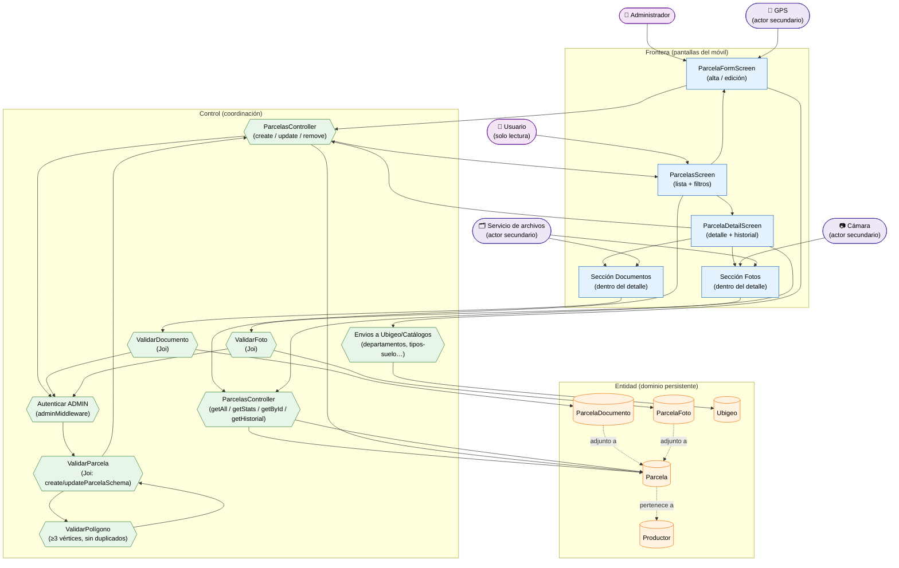

# Análisis de Robustez — Gestión de Parcelas (ICONIX · Parte 3)

> **Metodología ICONIX — Análisis de Robustez.** Misma convención que
> `03-robustez-registro-productores.md`:
>
> | Tipo | Símbolo | En este módulo |
> |---|---|---|
> | **Frontera** (*boundary*) | rectángulo azul | Pantallas del móvil |
> | **Control** (*control*) | hexágono verde | Controladores + validadores + middleware |
> | **Entidad** (*entity*) | cilindro naranja | Clases del Modelo de Dominio (Parte 1) |
> | **Actor secundario** | estadio violeta | GPS / cámara / servicio de archivos |

**Caso de uso cubierto:** UC-13 *Gestionar parcelas* (13.1 listado, 13.2 detalle + historial,
13.3 alta/edición con georreferenciación, 13.4 baja, 13.5 documentos y fotos).

---

## 1. Diagrama de robustez

---

## 2. Objetos identificados

### 2.1 Frontera (boundary)

| Objeto | Pantalla real | Caso de uso |
|---|---|---|
| `ParcelasScreen` | `apps/mobile/src/screens/ParcelasScreen.tsx` | UC-13.1 |
| `ParcelaFormScreen` | `ParcelaFormScreen.tsx` (compartida para alta y edición) | UC-13.3 |
| `ParcelaDetailScreen` | `ParcelaDetailScreen.tsx` | UC-13.2 / UC-13.4 |
| `Sección Documentos` | pestaña/sección dentro del detalle | UC-13.5 |
| `Sección Fotos` | pestaña/sección dentro del detalle | UC-13.5 |

> **Diferencia con productores:** aquí **no** hay pantalla de edición separada;
> `ParcelaFormScreen` asume ambos roles (alta y edición).

### 2.2 Control (control)

| Objeto | Implementación real | Responsabilidad |
|---|---|---|
| `ParcelasController` (lectura) | `apps/api/src/controllers/parcelas.controller.ts` | `getAll`, `getStats`, `getById`, `getHistorial`, `getDocumentos`, `getFotos` |
| `ParcelasController` (escritura) | mismo archivo | `create`, `update`, `remove` + CRUD de documentos/fotos |
| `ValidarParcela` | `apps/api/src/validators/parcelas.validator.ts` (`createParcelaSchema`, `updateParcelaSchema`) | RN-1…RN-6 de UC-13.3 |
| `ValidarPolígono` | `polygonValidation` del mismo validador | ≥3 vértices, rango lat/lng, sin duplicados |
| `Autenticar ADMIN` | `apps/api/src/middleware/auth.middleware.ts` (`adminMiddleware`) | Exige `rol = ADMIN` en escritura |
| `Envios a Ubigeo/Catálogos` | `ubigeo.controller.ts` / `catalogos.controller.ts` | Departamentos/provincias/distritos + tipos de suelo, agua, riego, zona |
| `ValidarDocumento` | `createParcelaDocumentoSchema` | RN-1 de UC-13.5 |
| `ValidarFoto` | `createParcelaFotoSchema` | RN-2 de UC-13.5 |

### 2.3 Entidad (entity)

| Objeto | Clase del Modelo de Dominio (Parte 1) | Persistencia |
|---|---|---|
| `Parcela` | `Parcela` | `parcelas_productor` |
| `ParcelaDocumento` | `ParcelaDocumento` | `documentos_parcela` |
| `ParcelaFoto` | `ParcelaFoto` | `fotos_parcela` |
| `Productor` | `Productor` | `productores` (FK obligatoria) |
| `Ubigeo` | `Ubigeo` | `ubigeo` |

### 2.4 Actores secundarios

| Actor | Función |
|---|---|
| 📱 **GPS** | Aporta `latitud`, `longitud`, `altitud`, `precision_gps` y polígono |
| 📷 **Cámara** | Captura fotos de la parcela |
| 🗂️ **Servicio de archivos** | `POST /api/upload/*` devuelve `ruta_archivo` |

---

## 3. Trazabilidad flujo → objetos

| Paso (UC-13.3) | Frontera | Control | Entidad |
|---|---|---|---|
| Abrir lista de parcelas | `ParcelasScreen` | `ParcelasController` (getAll) | `Parcela` |
| Cargar filtros (`comunidad`, `cultivo`, `estado`) | `ParcelasScreen` | `Envios a Ubigeo/Catálogos` | `CatalogoItem`, `Ubigeo` |
| Pulsar "Nueva" | `ParcelaFormScreen` | — | — |
| Seleccionar productor | `ParcelaFormScreen` | — | `Productor` |
| Tomar ubicación GPS / dibujar polígono | `ParcelaFormScreen` | `ValidarPolígono` | `Parcela` |
| Cargar desplegables | `ParcelaFormScreen` | `Envios a Ubigeo/Catálogos` | `Ubigeo`, `CatalogoItem` |
| Guardar | `ParcelaFormScreen` | `ParcelasController` (create) | `Parcela` |
| Verificar permiso | — | `Autenticar ADMIN` | `Usuario` |
| Validar campos | — | `ValidarParcela` | — |
| Ver detalle + historial | `ParcelaDetailScreen` | `ParcelasController` (getHistorial) | `Parcela` |
| Adjuntar documento / foto | `Sección Documentos`/`Fotos` | `ValidarDocumento`/`ValidarFoto` + `Servicio de archivos` | `ParcelaDocumento`, `ParcelaFoto` |
| Eliminar parcela | `ParcelaDetailScreen` | `ParcelasController` (remove) | `Parcela` |

---

## 4. Flujos alternos y excepciones

| Tipo | Condición | Reacción | Control |
|---|---|---|---|
| A1 | `codigo` vacío | El backend lo autogenera | `ParcelasController` |
| A2 | Alta sin polígono (solo punto GPS) | Se guarda `latitud`/`longitud` | `ValidarParcela` |
| E1 | Polígono con **< 3 vértices** | 400 "El polígono debe tener al menos 3 vértices" | `ValidarPolígono` |
| E2 | **Vértice duplicado** | 400 con índice del vértice | `ValidarPolígono` |
| E3 | Coordenada fuera de rango | 400 con índice | `ValidarPolígono` |
| E4 | `area_total` no positiva / falta `nombre` | 400 | `ValidarParcela` |
| E5 | `PUT` sin campos (`min(1)`) | 400 | `ValidarParcela` |
| E6 | Usuario no `ADMIN` en escritura | 403 | `Autenticar ADMIN` |
| E7 | Documento con MIME/tamaño inválido | 400 | `ValidarDocumento` |
| E8 | Fallo de GPS o de carga de archivos | El formulario permite captura manual y reintento | `ParcelaFormScreen` |

---

## 5. Hallazgos de la robustez

| # | Hallazgo | Impacto | Acción |
|---|---|---|---|
| R-1 | El **polígono** tiene validación propia (no solo Joi de tipos) | Entra en el diagrama como control separado (`ValidarPolígono`) | Incorporado |
| R-2 | `ParcelaFormScreen` es **compartida** para alta y edición | Diferente a productores (que tiene `ProductorEditScreen`) | Documentado |
| R-3 | Los **documentos y fotos** son sub-recursos con control propio | Son 2 casos de uso derivados de UC-13.5 | Añadidos al diagrama |
| R-4 | El **GPS** es un actor secundario, no un `participant` de dominio | Se modela como actor | Añadido |
| R-5 | `update` usa **`PUT`** (no `PATCH`), a diferencia de campañas (`PATCH`) | Relevante para la parte 5 (clases) y para la secuencia | Registrado |

> **Verificación ICONIX:** todos los mensajes del flujo tienen objeto de control asignado;
> no hay objetos huérfanos. Se puede avanzar al **diagrama de secuencia** de este caso de uso.

---

**Estado:** segundo diagrama de robustez. Continúan los demás casos de uso (Campo,
Calidad, Operaciones).
