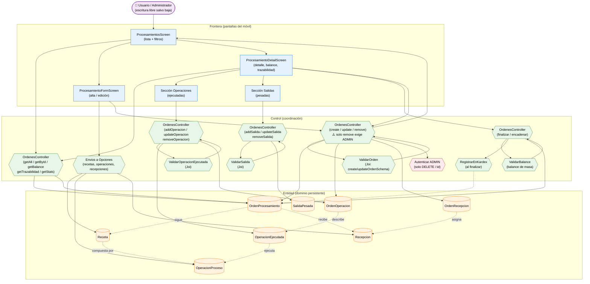

# Análisis de Robustez — Gestión de Órdenes de Procesamiento (ICONIX · Parte 3)

> **Misma convención:** 🟦 Frontera · 🟩 Control · 🟧 Entidad · 🟪 Actor secundario.
>
> **Corrección de rutas (verificada en `apps/api/src/app.ts`):** el módulo se monta en
> `/api/ordenes-procesamiento`, `/api/operaciones-proceso` y `/api/recetas`
> (no `/api/ordenes`, `/api/operaciones`, `/api/recepcion`). Los documentos previos
> (`02d`, diagramas) usaban las rutas cortas; este archivo las da **correctas**.

**Caso de uso cubierto:** UC-19 *Gestionar órdenes de procesamiento* (19.1 listado,
19.2 detalle + balance + trazabilidad, 19.3 alta, 19.4 operación ejecutada,
19.5 salida pesada, 19.6 finalizar, 19.7 encadenar, 19.8 baja).

---

## 1. Diagrama de robustez

---

## 2. Objetos identificados

### 2.1 Frontera

| Objeto | Pantalla real | Caso de uso |
|---|---|---|
| `ProcesamientosScreen` | `apps/mobile/src/screens/ProcesamientosScreen.tsx` | UC-19.1 |
| `ProcesamientoFormScreen` | `ProcesamientoFormScreen.tsx` (alta/edición) | UC-19.3 |
| `ProcesamientoDetailScreen` | `ProcesamientoDetailScreen.tsx` | UC-19.2 / UC-19.6–19.8 |
| `Sección Operaciones` | dentro del detalle | UC-19.4 |
| `Sección Salidas` | dentro del detalle | UC-19.5 |

### 2.2 Control

| Objeto | Implementación real | Responsabilidad |
|---|---|---|
| `OrdenesController` (lectura) | `apps/api/src/controllers/ordenes.controller.ts` | `getAll`, `getById`, `getBalance`, `getTrazabilidad`, `getStats` |
| `OrdenesController` (orden) | mismo archivo | `create`, `update`, `remove` |
| `OrdenesController` (operaciones) | mismo archivo | `addOperacion`, `updateOperacion`, `removeOperacion` |
| `OrdenesController` (salidas) | mismo archivo | `addSalida`, `updateSalida`, `removeSalida` |
| `OrdenesController` (cierre) | mismo archivo | `finalizar`, `encadenar` |
| `ValidarOrden` | `apps/api/src/validators/ordenes.validator.ts` | RN-1…RN-5 de UC-19.3 |
| `ValidarOperacionEjecutada` | `createOperacionEjecutadaSchema` | UC-19.4 |
| `ValidarSalida` | `createSalidaSchema` | RN-1…RN-4 de UC-19.5 |
| `Autenticar ADMIN` | `auth.middleware.ts` | **Solo** `DELETE /:id` |
| `Envios a Opciones` | `ordenes.ts` (`fetchRecetasActivas`, `fetchOperacionesActivas`, recepciones) | Desplegables del formulario |
| `ValidarBalance` | lógica de `ordenes.controller.ts` (`getBalance` + validación en `finalizar`) | Balance de masa antes de cerrar |
| `RegistrarEnKardex` | `ordenes.controller.ts` → `kardex` | Da entrada al inventario al finalizar |

### 2.3 Entidad

| Objeto | Clase (Parte 1) | Persistencia |
|---|---|---|
| `OrdenProcesamiento` | `OrdenProcesamiento` | `ordenes_procesamiento` |
| `OrdenOperacion` | `OrdenOperacion` | `orden_operaciones` |
| `OperacionEjecutada` | `OperacionEjecutada` | `operaciones_ejecutadas` |
| `SalidaPesada` | `SalidaPesada` | `salidas_pesadas` |
| `OrdenRecepcion` | `OrdenRecepcion` | `orden_recepciones` |
| `Receta` | `Receta` | `recetas` |
| `OperacionProceso` | `OperacionProceso` | `operaciones_proceso` |
| `Recepcion` | `Recepcion` | `recepciones` |

---

## 3. Trazabilidad flujo → objetos

| Paso (UC-19.3 / 19.4 / 19.5 / 19.6) | Frontera | Control | Entidad |
|---|---|---|---|
| Abrir lista de órdenes | `ProcesamientosScreen` | `OrdenesController` (getAll) | `OrdenProcesamiento` |
| Pulsar "Nueva orden" | `ProcesamientoFormScreen` | — | — |
| Seleccionar **receta** (precarga operaciones) | `ProcesamientoFormScreen` | `Envios a Opciones` | `Receta`, `OperacionProceso` |
| Asignar **recepciones** de entrada | `ProcesamientoFormScreen` | `Envios a Opciones` | `OrdenRecepcion`, `Recepcion` |
| Guardar orden | `ProcesamientoFormScreen` | `OrdenesController` (create) | `OrdenProcesamiento` |
| Registrar **operación ejecutada** | `Sección Operaciones` | `OrdenesController` (addOperacion) | `OperacionEjecutada` |
| Registrar **salida pesada** | `Sección Salidas` | `OrdenesController` (addSalida) | `SalidaPesada` |
| Ver **balance** y **trazabilidad** | `ProcesamientoDetailScreen` | `OrdenesController` (getBalance/getTrazabilidad) | `OrdenProcesamiento` |
| **Finalizar** (valida balance + kardex) | `ProcesamientoDetailScreen` | `ValidarBalance` + `RegistrarEnKardex` | `OrdenProcesamiento` |
| **Encadenar** etapa siguiente | `ProcesamientoDetailScreen` | `OrdenesController` (encadenar) | `OrdenProcesamiento` |
| Eliminar orden | `ProcesamientoDetailScreen` | `OrdenesController` (remove) + `Autenticar ADMIN` | `OrdenProcesamiento` |

---

## 4. Flujos alternos y excepciones

| Tipo | Condición | Reacción | Control |
|---|---|---|---|
| A1 | Sin `receta_id` | Se arman las operaciones a mano | `ValidarOrden` |
| A2 | `estado = BORRADOR` al crear | Válido; se cierra con `finalizar` | `ValidarOrden` |
| A3 | Edición parcial (`PUT` con mínimo 1 campo) | Válido | `ValidarOrden` |
| E1 | Falta `planta`, `responsable`, `fecha_inicio`, `etapa` o `producto_salida` | 400 | `ValidarOrden` |
| E2 | `etapa` fuera de {PRIMARIA, SECUNDARIA, EMPAQUE} | 400 | `ValidarOrden` |
| E3 | Recepción asignada con `cantidad_asignada` no positiva | 400 | `ValidarOrden` |
| E4 | Salida sin `tipo_salida`, `descripcion` o `cantidad` no positiva | 400 | `ValidarSalida` |
| E5 | **Balance de masa inconsistente** al finalizar | 400/409 con el detalle del descuadre | `ValidarBalance` |
| E6 | Usuario no `ADMIN` al **eliminar** | 403 | `Autenticar ADMIN` |

---

## 5. Hallazgos de la robustez

| # | Hallazgo | Impacto | Acción |
|---|---|---|---|
| R-1 | **RN-OPS-0 (seguridad):** solo `DELETE /:id` exige `ADMIN`. `create`, `update`, operaciones, salidas, `finalizar` y `encadenar` **son accesibles a cualquier usuario autenticado** | Inconsistencia de autorización | Marcado en rojo (`C4`) |
| R-2 | Rutas reales: `/api/ordenes-procesamiento`, `/api/operaciones-proceso`, `/api/recetas` | Corrige `02d` y diagramas previos | Registrado |
| R-3 | El **balance de masa** es un control propio (`ValidarBalance`) que solo actúa al `finalizar` | Diferente a otros módulos (validación al crear) | Control separado |
| R-4 | `finalizar` tiene **efecto lateral**: registra entrada en el **Kardex** | Acoplamiento entre UC-19 y UC-20 | Control `RegistrarEnKardex` |
| R-5 | `encadenar` **genera una nueva orden** (`orden_origen_id`) | Auto-referencia en el dominio | Documentado |
| R-6 | Las pantallas de Procesamiento **existen pero no están cableadas** en `AppStacks` (deuda D-2) | UC-19 no es accesible desde la navegación | **Deuda** |

> **Verificación ICONIX:** el flujo está completo; no hay objetos huérfanos. Se puede avanzar
> al **diagrama de secuencia** de este caso de uso.
