# Análisis de Robustez — Registro de Productores y sus Familiares (ICONIX · Parte 3)

> **Metodología ICONIX — Análisis de Robustez.** Valida que el modelo de casos de uso sea
> correcto y completo antes de dibujar secuencias. Por cada caso de uso se identifican tres
> tipos de objetos:
>
> | Tipo | Símbolo en el diagrama | Rol | En este módulo |
> |---|---|---|---|
> | **Frontera** (*boundary*) | rectángulo azul | Interfaz con el actor (pantalla) | Pantallas del móvil |
> | **Control** (*control*) | hexágono verde | Coordina/orquesta el caso de uso | Controladores + validadores + middleware |
> | **Entidad** (*entity*) | cilindro naranja | Datos del dominio (persistentes) | Clases del Modelo de Dominio (Parte 1) |
>
> **Nota Mermaid:** no existe tipo nativo de "robustness diagram"; se emula con `flowchart`
> usando una forma distinta por tipo de objeto (ver leyenda en el propio diagrama).

**Caso de uso cubierto:** UC-08 *Registrar productor* + UC-11.2/UC-11.3 *Gestionar familiares*
(incluido como caso de uso "extendido" desde el detalle del productor).

---

## 1. Diagrama de robustez

```mermaid
flowchart TB
    %% ─────────── ACTOR ───────────
    Act(["👤 Administrador"])

    %% ─────────── FRONTERA (boundary) ───────────
    subgraph FRONTERA["Frontera (pantallas del móvil)"]
        B1["ProductoresScreen<br/>(lista)"]
        B2["ProductorCreateScreen<br/>(formulario alta)"]
        B3["ProductorEditScreen<br/>(formulario edición)"]
        B4["ProductorDetailScreen<br/>(detalle)"]
        B5["FamiliaresScreen<br/>(lista familiares)"]
        B6["FamiliarCreateScreen<br/>(formulario alta)"]
        B7["FamiliarEditScreen<br/>(formulario edición)"]
    end

    %% ─────────── CONTROL ───────────
    subgraph CONTROL["Control (coordinación)"]
        C1{{"ProductoresController<br/>(crear/editar/eliminar)"}}
        C2{{"ValidarProductor<br/>(Joi)"}}
        C3{{"Autenticar ADMIN<br/>(adminMiddleware)"}}
        C4{{"Envios a Ubigeo/Catálogos<br/>(getAll / getActivos)"}}
        C5{{"FamiliaresController<br/>(crear/editar/eliminar)"}}
        C6{{"ValidarFamiliar<br/>(Joi)"}}
    end

    %% ─────────── ENTIDAD ───────────
    subgraph ENTIDAD["Entidad (dominio persistente)"]
        E1[("Productor")]
        E2[("Familiar")]
        E3[("Ubigeo")]
        E4[("CatalogoItem")]
    end

    %% ─────────── FLUJO ───────────
    Act --> B1
    B1 --> B2
    B1 --> B4

    %% Alta de productor (flujo normal UC-08)
    B2 --> C1
    C1 --> C3
    C3 --> C2
    C2 --> C1
    C1 --> E1
    C1 --> C4
    C4 --> E3
    C4 --> E4
    C1 --> B1

    %% Edición / baja (UC-09, UC-10)
    B4 --> B3
    B3 --> C1
    C1 --> E1

    %% Gestionar familiares (UC-11, incluido desde el detalle)
    B4 --> B5
    B5 --> B6
    B5 --> B7
    B6 --> C5
    B7 --> C5
    C5 --> C3
    C3 --> C6
    C6 --> C5
    C5 --> E2
    E2 -. "pertenece a" .-> E1
    C5 --> B5

    %% ─────────── LEYENDA / ESTILOS ───────────
    classDef actor     fill:#f3e5f5,stroke:#6a1b9a,color:#000;
    classDef boundary  fill:#e3f2fd,stroke:#1565c0,color:#000;
    classDef control   fill:#e8f5e9,stroke:#2e7d32,color:#000;
    classDef entity    fill:#fff3e0,stroke:#ef6c00,color:#000;

    class Act actor
    class B1,B2,B3,B4,B5,B6,B7 boundary
    class C1,C2,C3,C4,C5,C6 control
    class E1,E2,E3,E4 entity
```

---

## 2. Objetos identificados

### 2.1 Frontera (boundary)

| Objeto | Pantalla real | Caso de uso |
|---|---|---|
| `ProductoresScreen` | `apps/mobile/src/screens/ProductoresScreen.tsx` | UC-06 |
| `ProductorCreateScreen` | `ProductorCreateScreen.tsx` | UC-08 |
| `ProductorDetailScreen` | `ProductorDetailScreen.tsx` | UC-07 |
| `ProductorEditScreen` | `ProductorEditScreen.tsx` | UC-09 / UC-10 |
| `FamiliaresScreen` | `FamiliaresScreen.tsx` | UC-11.1 |
| `FamiliarCreateScreen` | `FamiliarCreateScreen.tsx` | UC-11.2 |
| `FamiliarEditScreen` | `FamiliarEditScreen.tsx` | UC-11.3 / UC-11.4 |

### 2.2 Control (control)

| Objeto | Implementación real | Responsabilidad |
|---|---|---|
| `ProductoresController` | `apps/api/src/controllers/productores.controller.ts` | Orquesta el CRUD de productores y familiares |
| `ValidarProductor` | `apps/api/src/validators/productores.validator.ts` (Joi) | Aplica RN-1…RN-9 de UC-08 |
| `Autenticar ADMIN` | `apps/api/src/middleware/auth.middleware.ts` (`adminMiddleware`) | Exige `rol = ADMIN` para escritura |
| `Envios a Ubigeo/Catálogos` | `ubigeo.controller.ts` / `catalogos.controller.ts` | Rellena desplegables del formulario |
| `FamiliaresController` | `productores.controller.ts` (rutas `/productores/:id/familiares`) | CRUD de familiares |
| `ValidarFamiliar` | `productores.validator.ts` (`createFamiliarSchema`) | Aplica RN-1…RN-4 de UC-11.2 |

### 2.3 Entidad (entity)

| Objeto | Clase del Modelo de Dominio (Parte 1) | Persistencia |
|---|---|---|
| `Productor` | `Productor` | tabla `productores` |
| `Familiar` | `Familiar` | tabla `familiares_productor` |
| `Ubigeo` | `Ubigeo` | tabla `ubigeo` |
| `CatalogoItem` | `CatalogoItem` | tabla de catálogos |

---

## 3. Trazabilidad flujo del caso de uso → objetos

| Paso del flujo (UC-08) | Frontera | Control | Entidad |
|---|---|---|---|
| Abrir lista de productores | `ProductoresScreen` | — | `Productor` (lectura) |
| Pulsar "Nuevo" | `ProductorCreateScreen` | — | — |
| Completar datos y guardar | `ProductorCreateScreen` | `ProductoresController` | `Productor` |
| Verificar permiso | — | `Autenticar ADMIN` | `Usuario` |
| Validar campos | — | `ValidarProductor` | — |
| Cargar ubigeo/catálogos | `ProductorCreateScreen` | `Envios a Ubigeo/Catálogos` | `Ubigeo`, `CatalogoItem` |
| Ver detalle | `ProductorDetailScreen` | — | `Productor` |
| Abrir familiares | `FamiliaresScreen` | — | `Familiar` |
| Registrar familiar | `FamiliarCreateScreen` | `FamiliaresController` + `ValidarFamiliar` | `Familiar` → `Productor` |

---

## 4. Flujos alternos y excepciones (robustez)

| Tipo | Condición | Reacción del sistema | Objeto de control |
|---|---|---|---|
| A1 | Código autogenerado | El backend genera `codigo` si no se envía | `ProductoresController` |
| E1 | **DNI duplicado** | 409 → mensaje en `ProductorCreateScreen` | `ValidarProductor` |
| E2 | Campos obligatorios faltantes | 400 con detalle por campo | `ValidarProductor` |
| E3 | Usuario no `ADMIN` | 403 "Acceso denegado…" | `Autenticar ADMIN` |
| E4 | Fallo al cargar ubigeo/catálogo | El formulario muestra campos vacíos y permite reintentar | `Envios a Ubigeo/Catálogos` |

> **Corrección aportada por la robustez:** el flujo exige un objeto de control explícito para
> **la carga de ubigeo y catálogos** (desplegables), que no aparecía como paso en la
> descripción textual del caso de uso (Parte 2). Se incorpora aquí.

---

**Estado:** primer diagrama de robustez. Continúan los demás casos de uso de Campo, Calidad y
Operaciones.
