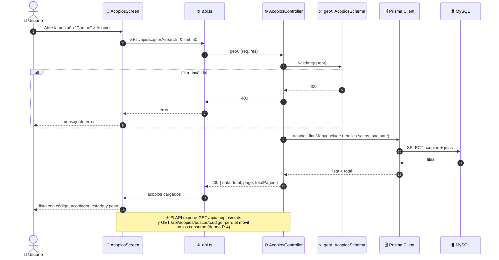
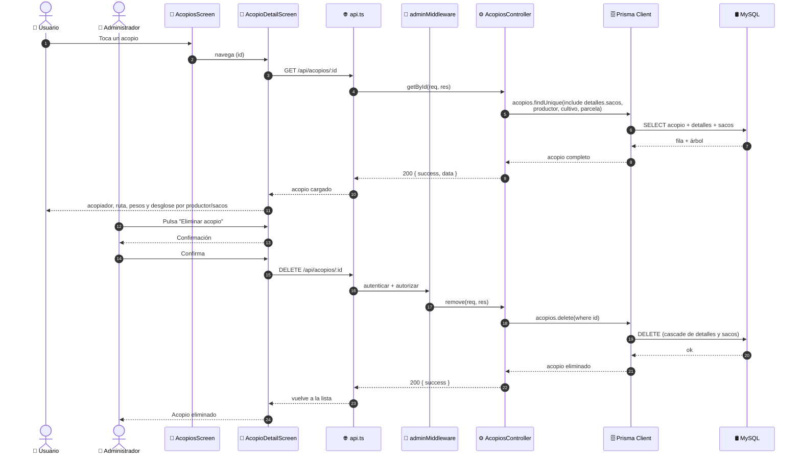

# Diagramas de Secuencia — Gestión de Acopios (ICONIX · Parte 4)

> Se derivan del análisis de robustez `03-robustez-gestion-acopios.md`.
> Cada objeto boundary/control/entity se convierte en un `participant`.
>
> **Nota de arquitectura (R-1):** a diferencia de los demás módulos, acopios **no tiene capa
> de servicio**; las pantallas llaman `api.ts` **directamente**. Por eso el `participant`
> `Servicio` **no aparece** en estos diagramas.

**Caso de uso cubierto:** UC-17 *Gestionar acopios* (17.1 listado/búsqueda, 17.2 detalle,
17.3 alta/edición con detalles y sacos, 17.4 baja).

---

## 1. Participantes

| `participant` | Rol | Módulo |
|---|---|---|
| `Actor` | 👤 Administrador / Usuario | humano |
| `Pantalla` | 📱 `AcopiosScreen` / `AcopioFormScreen` / `AcopioDetailScreen` | móvil |
| `API` | 🌐 `api.ts` (Axios + interceptor de refresh) | móvil |
| `Middleware` | 🔐 `adminMiddleware` | API |
| `Controlador` | ⚙️ `acopios.controller.ts` | API |
| `Validador` | ✅ `acopios.validator.ts` (Joi) | API |
| `Listas` | ✅ `ValidarListas` (detalles → sacos) | API |
| `Pesos` | ✅ `ValidarPesos` (custom) | API |
| `Prisma` | 🗄️ Prisma Client | API |
| `BD` | 🛢️ MySQL | base de datos |

---

## 2. UC-17.1 · Listado y búsqueda (solo lectura)



---

## 3. UC-17.3 · Registrar / editar acopio (principal, con detalles y sacos)

```mermaid
sequenceDiagram
    autonumber
    actor Actor as 👤 Administrador
    participant Pantalla as 📱 AcopioFormScreen
    participant API as 🌐 api.ts (interceptor)
    participant Middleware as 🔐 adminMiddleware
    participant Controlador as ⚙️ AcopiosController
    participant Validador as ✅ ValidarAcopio (Joi)
    participant Pesos as ✅ ValidarPesos (custom)
    participant Listas as ✅ ValidarListas
    participant Prisma as 🗄️ Prisma Client
    participant BD as 🛢️ MySQL

    Actor->>Pantalla: Pulsa "Nuevo acopio"
    Pantalla->>API: GET /api/productores / /cultivos / /parcelas
    API-->>Pantalla: 200 { data }
    Pantalla-->>Actor: desplegables poblados

    Actor->>Pantalla: Ingresa fecha, acopiador, vehículo y ruta
    Actor->>Pantalla: Captura peso_bruto y tara
    Pantalla->>Pantalla: calcula peso_neto = peso_bruto − tara

    Actor->>Pantalla: Agrega detalles (productor + cultivo + parcela)
    Actor->>Pantalla: Agrega sacos (código + peso) por detalle
    Actor->>Pantalla: Pulsa "Guardar"

    Pantalla->>API: POST /api/acopios<br/>{ acopiador, vehiculo, ruta_acopio, estado,<br/>peso_bruto, tara, detalles: [{..., sacos: [...] }] }
    API->>Middleware: autenticar + autorizar
    Middleware->>Middleware: Verifica rol = ADMIN

    alt rol ≠ ADMIN
        Middleware-->>API: 403 Acceso denegado
        API-->>Pantalla: error
        Pantalla-->>Actor: "Acceso denegado"
    end

    Middleware->>Controlador: create(req, res)
    Controlador->>Validador: validate(createAcopioSchema)
    Validador->>Validador: valida obligatorios y enums

    alt falta fecha o acopiador
        Validador-->>Controlador: 400
        Controlador-->>API: 400
        API-->>Pantalla: error de validación
        Pantalla-->>Actor: Resalta campos inválidos
    end

    Validador->>Listas: validar(detalles → sacos)

    alt sin detalles
        Listas-->>Validador: 400 "Debe agregar al menos un productor"
        Validador-->>Controlador: 400
        Controlador-->>API: 400
        API-->>Pantalla: error
        Pantalla-->>Actor: Agrega al menos un detalle
    end

    alt detalle sin sacos
        Listas-->>Validador: 400 "Debe agregar al menos un saco"
        Validador-->>Controlador: 400
        Controlador-->>API: 400
        API-->>Pantalla: error
        Pantalla-->>Actor: Agrega sacos al detalle
    end

    Validador->>Pesos: validar(tara, peso_bruto, codigos de sacos)
    Pesos->>Pesos: verifica tara ≤ peso_bruto<br/>y unicidad de código de saco

    alt tara > peso_bruto
        Pesos-->>Validador: 400 "La tara no puede ser mayor al peso bruto"
        Validador-->>Controlador: 400
        Controlador-->>API: 400
        API-->>Pantalla: error
        Pantalla-->>Actor: Corrige los pesos
    end

    alt código de saco duplicado
        Pesos-->>Validador: 400 "El código del saco X está duplicado"
        Validador-->>Controlador: 400
        Controlador-->>API: 400
        API-->>Pantalla: error
        Pantalla-->>Actor: Corrige el código repetido
    end

    Controlador->>Prisma: acopios.create(data + detalles + sacos)
    Prisma->>BD: BEGIN TX<br/>INSERT acopios<br/>INSERT acopio_detalles<br/>INSERT acopio_sacos<br/>COMMIT
    BD-->>Prisma: ids
    Prisma-->>Controlador: Acopio creado con sus detalles y sacos
    Controlador-->>API: 201 { success, data }
    API-->>Pantalla: acopio persistido
    Pantalla-->>Actor: Vuelve a la lista

    Note over Actor,BD: La edición es idéntica pero con<br/>PUT /api/acopios/:id y updateAcopioSchema<br/>(mínimo 1 campo; las listas enviadas REEMPLAZAN<br/>las existentes)
```

---

## 4. UC-17.2 · Detalle y UC-17.4 · Eliminar acopio



---

## 5. Verificación de robustez (hallazgos)

| # | Hallazgo durante la secuencia | ¿Afecta al caso de uso? | Acción |
|---|---|---|---|
| S-1 | **No hay `Servicio`**: la pantalla habla con `api.ts` directamente | Sí — arquitectura | Reflejado (no aparece participant `Servicio`) |
| S-2 | El **cálculo del peso neto** ocurre en el cliente; la **validación** en el API | Sí — separa frontera de control | Reflejado |
| S-3 | `ValidarPesos` (custom) valida **tara ≤ bruto** y **unicidad de código de saco** | Sí — control separado | Reflejado como participant |
| S-4 | El alta es una **transacción** (acopio + detalles + sacos) | Sí — atomicidad | Mostrado con `BEGIN TX … COMMIT` |
| S-5 | `updateAcopio` usa **`PUT`** y las listas **reemplazan** | Sí — contrato del API | Registrado (R-3) |
| S-6 | `/stats` y `/buscar/:codigo` **no se consumen** | Deuda R-4 | Documentada |

> **Verificación ICONIX:** todos los mensajes tienen objeto de robustez asignado. Puede
> avanzarse a la **Parte 5 — Diagrama de Clases**.
