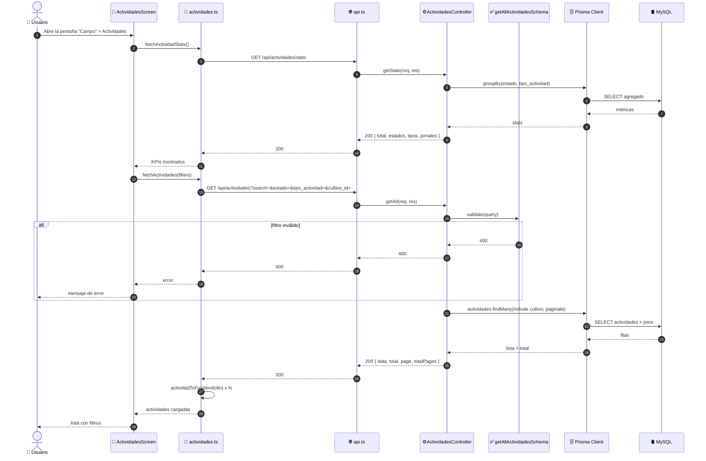
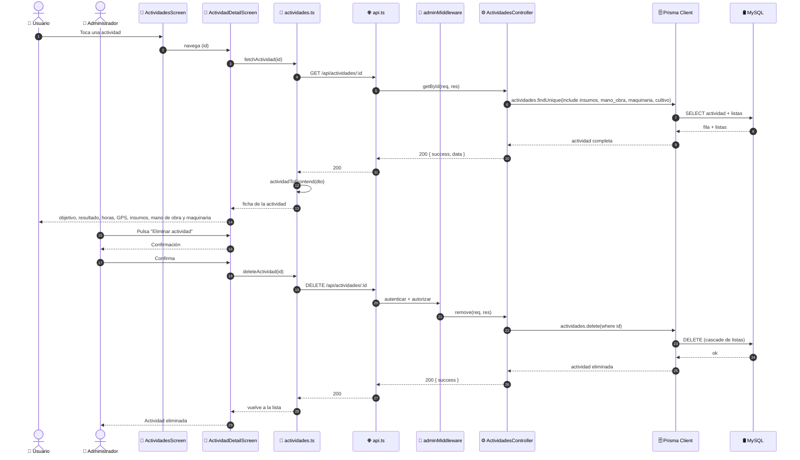

# Diagramas de Secuencia — Gestión de Actividades Agrícolas (ICONIX · Parte 4)

> Se derivan del análisis de robustez `03-robustez-gestion-actividades.md`.
> Cada objeto boundary/control/entity se convierte en un `participant`.

**Caso de uso cubierto:** UC-15 *Gestionar actividades* (15.1 listado, 15.2 detalle,
15.3 alta/edición con insumos, mano de obra y maquinaria, 15.4 baja).

---

## 1. Participantes

| `participant` | Rol | Módulo |
|---|---|---|
| `Actor` | 👤 Administrador / Usuario | humano |
| `Pantalla` | 📱 `ActividadesScreen` / `ActividadFormScreen` / `ActividadDetailScreen` | móvil |
| `Opciones` | 📱 `catalogos.ts` (cultivos) | móvil |
| `Servicio` | 📱 `actividades.ts` | móvil |
| `API` | 🌐 `api.ts` (Axios + interceptor de refresh) | móvil |
| `Middleware` | 🔐 `adminMiddleware` | API |
| `Controlador` | ⚙️ `actividades.controller.ts` | API |
| `Validador` | ✅ `actividades.validator.ts` (Joi) | API |
| `Listas` | ✅ `ValidarListas` (insumos/mano de obra/maquinaria) | API |
| `Prisma` | 🗄️ Prisma Client | API |
| `BD` | 🛢️ MySQL | base de datos |

---

## 2. UC-15.1 · Listado, filtros y estadísticas (solo lectura)



---

## 3. UC-15.3 · Registrar / editar actividad (principal, con las 3 listas)

```mermaid
sequenceDiagram
    autonumber
    actor Actor as 👤 Administrador
    participant Pantalla as 📱 ActividadFormScreen
    participant Opciones as 📱 catalogos.ts
    participant Servicio as 📱 actividades.ts
    participant API as 🌐 api.ts (interceptor)
    participant Middleware as 🔐 adminMiddleware
    participant Controlador as ⚙️ ActividadesController
    participant Validador as ✅ ValidarActividad (Joi)
    participant Listas as ✅ ValidarListas
    participant Prisma as 🗄️ Prisma Client
    participant BD as 🛢️ MySQL

    Actor->>Pantalla: Pulsa "Nueva actividad"
    Pantalla->>Opciones: fetchCultivosOpciones()
    Opciones->>API: GET /api/cultivos?limit=500
    API-->>Opciones: 200 { data }
    Opciones-->>Pantalla: desplegable de cultivos

    Actor->>Pantalla: Captura GPS (latitud/longitud/altitud/precisión)
    Actor->>Pantalla: Agrega filas de insumos, mano de obra y maquinaria
    Actor->>Pantalla: Completa datos y pulsa "Guardar"

    Pantalla->>Servicio: createActividad(datos)
    Servicio->>Servicio: payload + mapInsumosToBackend()<br/>+ mapManoObraToBackend() + mapMaquinariaToBackend()
    Servicio->>API: POST /api/actividades (Bearer token)
    API->>Middleware: autenticar + autorizar
    Middleware->>Middleware: Verifica rol = ADMIN

    alt rol ≠ ADMIN
        Middleware-->>API: 403 Acceso denegado
        API-->>Servicio: 403
        Servicio-->>Pantalla: error
        Pantalla-->>Actor: "Acceso denegado"
    end

    Middleware->>Controlador: create(req, res)
    Controlador->>Validador: validate(createActividadSchema)
    Validador->>Validador: valida obligatorios y enums

    alt falta cultivo_id, fecha, tipo_actividad o responsable_tecnico
        Validador-->>Controlador: 400
        Controlador-->>API: 400
        API-->>Servicio: 400
        Servicio-->>Pantalla: error de validación
        Pantalla-->>Actor: Resalta campos inválidos
    end

    alt hora_inicio / hora_fin con formato ≠ HH:MM
        Validador-->>Controlador: 400 "Formato de hora inválido (HH:MM)"
        Controlador-->>API: 400
        API-->>Servicio: 400
        Servicio-->>Pantalla: error
        Pantalla-->>Actor: Corrige la hora
    end

    Validador->>Listas: validar(insumos, mano_obra, maquinaria)
    Listas->>Listas: cada insumo exige producto<br/>cada trabajador exige nombre<br/>cada equipo exige nombre

    alt fila sin su campo obligatorio
        Listas-->>Validador: 400
        Validador-->>Controlador: 400
        Controlador-->>API: 400
        API-->>Servicio: 400
        Servicio-->>Pantalla: error
        Pantalla-->>Actor: Corrige la fila incompleta
    end

    Controlador->>Prisma: actividades.create(data + listas anidadas)
    Prisma->>BD: BEGIN TX<br/>INSERT actividades<br/>INSERT actividad_insumos<br/>INSERT actividad_manobra<br/>INSERT actividad_maquinaria<br/>COMMIT
    BD-->>Prisma: ids
    Prisma-->>Controlador: Actividad creada con sus listas
    Controlador-->>API: 201 { success, data }
    API-->>Servicio: 201
    Servicio->>Servicio: actividadToFrontend(res)
    Servicio-->>Pantalla: actividad persistida
    Pantalla-->>Actor: Vuelve a la lista

    Note over Actor,BD: La edición es idéntica pero con<br/>PUT /api/actividades/:id y updateActividadSchema<br/>(mínimo 1 campo; las listas enviadas REEMPLAZAN<br/>las existentes)
```

---

## 4. UC-15.2 · Detalle y UC-15.4 · Eliminar actividad



---

## 5. Verificación de robustez (hallazgos)

| # | Hallazgo durante la secuencia | ¿Afecta al caso de uso? | Acción |
|---|---|---|---|
| S-1 | 3 mappers propios (`mapInsumosToBackend`, `mapManoObraToBackend`, `mapMaquinariaToBackend`) | Sí — complejidad del caso de uso | Reflejado en la secuencia |
| S-2 | `updateActividad` usa **`PUT`** y las listas **reemplazan** | Sí — contrato del API | Registrado (R-1, R-3) |
| S-3 | `ValidarListas` valida cada fila por separado | Sí — control separado | Reflejado como participant |
| S-4 | El alta/edición es una **transacción** (actividad + 3 listas) | Sí — atomicidad | Mostrado con `BEGIN TX … COMMIT` |
| S-5 | El formulario exige cargar **cultivos** antes del alta | Sí — control `Opciones` | Incorporado |
| S-6 | `actividad_fotos` no existe en el flujo | Deuda R-6 | No modelado |

> **Verificación ICONIX:** todos los mensajes tienen objeto de robustez asignado. Puede
> avanzarse a la **Parte 5 — Diagrama de Clases**.
