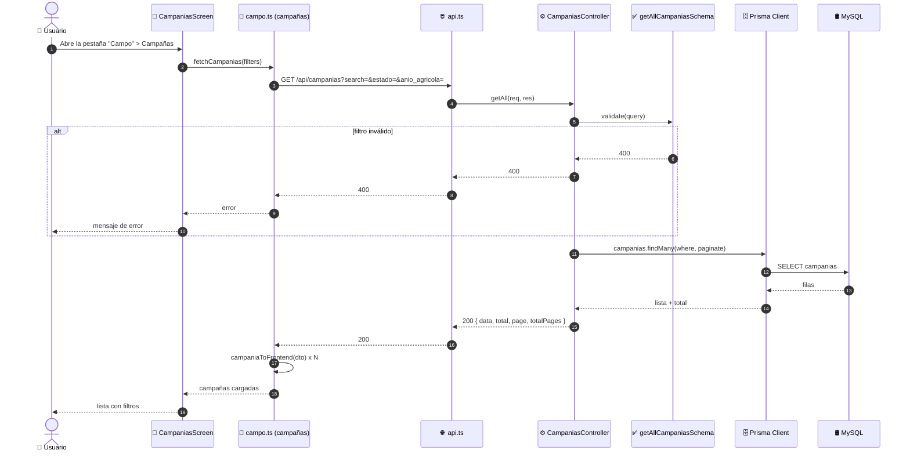
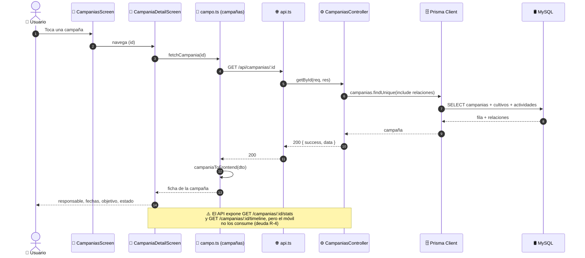

# Diagramas de Secuencia — Gestión de Campañas (ICONIX · Parte 4)

> Se derivan del análisis de robustez `03-robustez-gestion-campanias.md`.
> Cada objeto boundary/control/entity se convierte en un `participant`.

**Caso de uso cubierto:** UC-12 *Gestionar campañas* (12.1 listado, 12.2 detalle,
12.3 alta/edición, 12.4 baja).

---

## 1. Participantes

| `participant` | Rol | Módulo |
|---|---|---|
| `Actor` | 👤 Administrador / Usuario | humano |
| `Pantalla` | 📱 `CampaniasScreen` / `CampaniaFormScreen` / `CampaniaDetailScreen` | móvil |
| `Servicio` | 📱 `campo.ts` (campañas) | móvil |
| `API` | 🌐 `api.ts` (Axios + interceptor de refresh) | móvil |
| `Middleware` | 🔐 `adminMiddleware` | API |
| `Controlador` | ⚙️ `campanias.controller.ts` | API |
| `Validador` | ✅ `campanias.validator.ts` (Joi) | API |
| `Fechas` | ✅ `ValidarFechas` (custom) | API |
| `Prisma` | 🗄️ Prisma Client | API |
| `BD` | 🛢️ MySQL | base de datos |

---

## 2. UC-12.1 · Listado y filtros (solo lectura)



---

## 3. UC-12.3 · Registrar / editar campaña (principal)

```mermaid
sequenceDiagram
    autonumber
    actor Actor as 👤 Administrador
    participant Pantalla as 📱 CampaniaFormScreen
    participant Servicio as 📱 campo.ts (campañas)
    participant API as 🌐 api.ts (interceptor)
    participant Middleware as 🔐 adminMiddleware
    participant Controlador as ⚙️ CampaniasController
    participant Validador as ✅ ValidarCampania (Joi)
    participant Fechas as ✅ ValidarFechas (custom)
    participant Prisma as 🗄️ Prisma Client
    participant BD as 🛢️ MySQL

    Actor->>Pantalla: Pulsa "Nueva campaña"
    Pantalla->>Pantalla: muestra formulario (estado por defecto PLANIFICADA)

    Actor->>Pantalla: Completa datos y pulsa "Guardar"
    Pantalla->>Servicio: createCampania(datos)
    Servicio->>Servicio: campaniaToBackend(datos)<br/>(fechaInicio→fecha_inicio, tecnicoCoordinador→tecnico_coordinador)
    Servicio->>API: POST /api/campanias (Bearer token)
    API->>Middleware: autenticar + autorizar
    Middleware->>Middleware: Verifica rol = ADMIN

    alt rol ≠ ADMIN
        Middleware-->>API: 403 Acceso denegado
        API-->>Servicio: 403
        Servicio-->>Pantalla: error
        Pantalla-->>Actor: "Acceso denegado"
    end

    Middleware->>Controlador: create(req, res)
    Controlador->>Validador: validate(createCampaniaSchema)
    Validador->>Validador: valida obligatorios y enums

    alt datos obligatorios faltantes
        Validador-->>Controlador: 400 (nombre / responsable / tecnico_coordinador / objetivo)
        Controlador-->>API: 400
        API-->>Servicio: 400
        Servicio-->>Pantalla: error de validación
        Pantalla-->>Actor: Resalta campos inválidos
    end

    alt anio_agricola con formato ≠ YYYY-YYYY
        Validador-->>Controlador: 400
        Controlador-->>API: 400
        API-->>Servicio: 400
        Servicio-->>Pantalla: error
        Pantalla-->>Actor: "Formato 2025-2026"
    end

    Validador->>Fechas: validar(fecha_inicio, fecha_fin)

    alt fecha_fin ≤ fecha_inicio
        Fechas-->>Validador: 400 "La fecha de fin debe ser posterior a la de inicio"
        Validador-->>Controlador: 400
        Controlador-->>API: 400
        API-->>Servicio: 400
        Servicio-->>Pantalla: error
        Pantalla-->>Actor: Indica el rango de fechas
    end

    Controlador->>Prisma: campanias.create(data)
    Prisma->>BD: INSERT INTO campanias
    BD-->>Prisma: id + codigo generado
    Prisma-->>Controlador: Campaña creada
    Controlador-->>API: 201 { success, data }
    API-->>Servicio: 201
    Servicio->>Servicio: campaniaToFrontend(res)
    Servicio-->>Pantalla: campaña persistida
    Pantalla-->>Actor: Vuelve a la lista

    Note over Actor,BD: La edición es idéntica pero con<br/>PATCH /api/campanias/:id y updateCampaniaSchema<br/>(mínimo 1 campo; revalida el orden de fechas)
```

---

## 4. UC-12.2 · Detalle de campaña



---

## 5. UC-12.4 · Eliminar campaña

```mermaid
sequenceDiagram
    autonumber
    actor Actor as 👤 Administrador
    participant Detalle as 📱 CampaniaDetailScreen
    participant Servicio as 📱 campo.ts (campañas)
    participant API as 🌐 api.ts
    participant Middleware as 🔐 adminMiddleware
    participant Controlador as ⚙️ CampaniasController
    participant Prisma as 🗄️ Prisma Client
    participant BD as 🛢️ MySQL

    Actor->>Detalle: Pulsa "Eliminar campaña"
    Detalle-->>Actor: Confirmación
    Actor->>Detalle: Confirma
    Detalle->>Servicio: deleteCampania(id)
    Servicio->>API: DELETE /api/campanias/:id
    API->>Middleware: autenticar + autorizar
    Middleware->>Controlador: remove(req, res)
    Controlador->>Prisma: campanias.delete(where id)
    Prisma->>BD: DELETE (o soft-delete)
    BD-->>Prisma: ok
    Prisma-->>Controlador: campaña eliminada
    Controlador-->>API: 200 { success }
    API-->>Servicio: 200
    Servicio-->>Detalle: vuelve a la lista
    Detalle-->>Actor: Campaña eliminada
```

---

## 6. Verificación de robustez (hallazgos)

| # | Hallazgo durante la secuencia | ¿Afecta al caso de uso? | Acción |
|---|---|---|---|
| S-1 | `campaniaToBackend()` / `campaniaToFrontend()` hacen el mapeo camel↔snake | Sí — no era explícito | Reflejado en la secuencia |
| S-2 | `updateCampania` usa **`PATCH`**, no `PUT` | Sí — contrato del API | Registrado (R-1 de robustez) |
| S-3 | `ValidarFechas` es una **función custom**, no un esquema Joi | Sí — control separado | Reflejado como participant |
| S-4 | `/stats` y `/:id/timeline` existen pero **no se llaman** | Sí — flujo incompleto en el móvil | Deuda R-4, documentada |
| S-5 | El formulario **no** permite editar `permitir_*`, `activa`, `visible` | Sí — deuda R-3 | Documentada |

> **Verificación ICONIX:** todos los mensajes tienen objeto de robustez asignado. Puede
> avanzarse a la **Parte 5 — Diagrama de Clases**.
