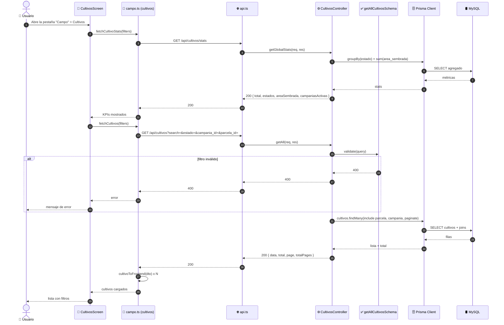
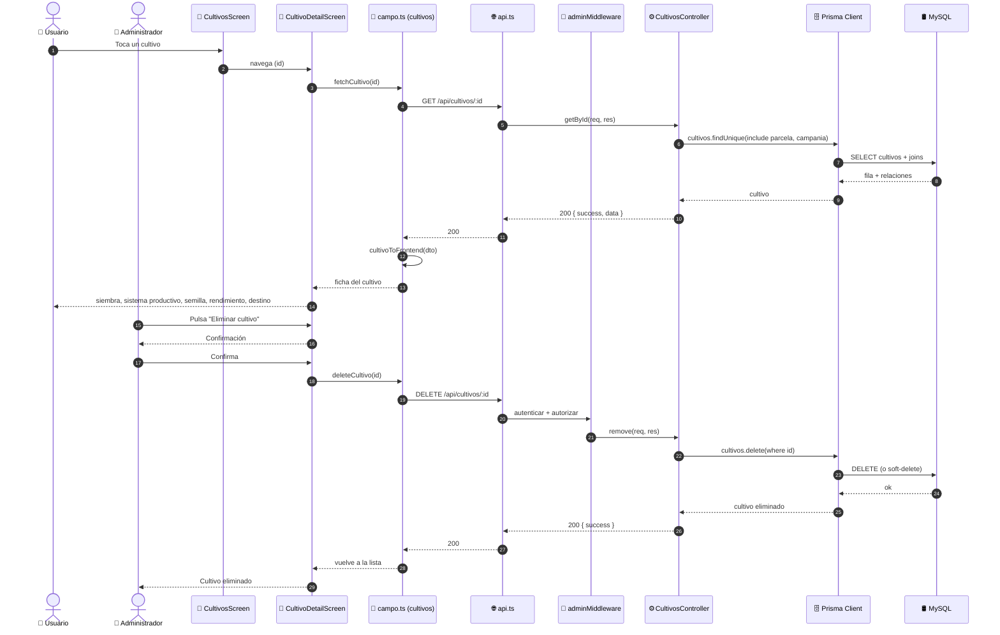

# Diagramas de Secuencia — Gestión de Cultivos (ICONIX · Parte 4)

> Se derivan del análisis de robustez `03-robustez-gestion-cultivos.md`.
> Cada objeto boundary/control/entity se convierte en un `participant`.

**Caso de uso cubierto:** UC-14 *Gestionar cultivos* (14.1 listado, 14.2 detalle,
14.3 alta/edición, 14.4 baja).

---

## 1. Participantes

| `participant` | Rol | Módulo |
|---|---|---|
| `Actor` | 👤 Administrador / Usuario | humano |
| `Pantalla` | 📱 `CultivosScreen` / `CultivoFormScreen` / `CultivoDetailScreen` | móvil |
| `Servicio` | 📱 `campo.ts` (cultivos) | móvil |
| `Opciones` | 📱 `catalogos.ts` (campañas/parcelas) | móvil |
| `API` | 🌐 `api.ts` (Axios + interceptor de refresh) | móvil |
| `Middleware` | 🔐 `adminMiddleware` | API |
| `Controlador` | ⚙️ `cultivos.controller.ts` | API |
| `Validador` | ✅ `cultivos.validator.ts` (Joi) | API |
| `Fechas` | ✅ `ValidarFechas` (custom) | API |
| `Prisma` | 🗄️ Prisma Client | API |
| `BD` | 🛢️ MySQL | base de datos |

---

## 2. UC-14.1 · Listado, filtros y estadísticas (solo lectura)



---

## 3. UC-14.3 · Registrar / editar cultivo (principal)

```mermaid
sequenceDiagram
    autonumber
    actor Actor as 👤 Administrador
    participant Pantalla as 📱 CultivoFormScreen
    participant Opciones as 📱 catalogos.ts
    participant Servicio as 📱 campo.ts (cultivos)
    participant API as 🌐 api.ts (interceptor)
    participant Middleware as 🔐 adminMiddleware
    participant Controlador as ⚙️ CultivosController
    participant Validador as ✅ ValidarCultivo (Joi)
    participant Fechas as ✅ ValidarFechas (custom)
    participant Prisma as 🗄️ Prisma Client
    participant BD as 🛢️ MySQL

    Actor->>Pantalla: Pulsa "Nuevo cultivo"
    Pantalla->>Opciones: fetchCampaniasOpciones()
    Opciones->>API: GET /api/campanias?limit=500
    API-->>Opciones: 200 { data }
    Opciones-->>Pantalla: desplegable de campañas

    Pantalla->>Opciones: fetchParcelasOpciones()
    Opciones->>API: GET /api/parcelas?limit=500
    API-->>Opciones: 200 { data }
    Opciones-->>Pantalla: desplegable de parcelas

    Actor->>Pantalla: Selecciona campaña y parcela, completa datos
    Actor->>Pantalla: Pulsa "Guardar"
    Pantalla->>Servicio: createCultivo(datos)
    Servicio->>Servicio: cultivoToBackend(datos)<br/>(campaniaId→campania_id, parcelaId→parcela_id)
    Servicio->>API: POST /api/cultivos (Bearer token)
    API->>Middleware: autenticar + autorizar
    Middleware->>Middleware: Verifica rol = ADMIN

    alt rol ≠ ADMIN
        Middleware-->>API: 403 Acceso denegado
        API-->>Servicio: 403
        Servicio-->>Pantalla: error
        Pantalla-->>Actor: "Acceso denegado"
    end

    Middleware->>Controlador: create(req, res)
    Controlador->>Validador: validate(createCultivoSchema)
    Validador->>Validador: valida obligatorios y enums

    alt falta campania_id o parcela_id
        Validador-->>Controlador: 400 "La campaña es obligatoria" / "La parcela es obligatoria"
        Controlador-->>API: 400
        API-->>Servicio: 400
        Servicio-->>Pantalla: error de validación
        Pantalla-->>Actor: Resalta el desplegable vacío
    end

    alt area_sembrada no positiva
        Validador-->>Controlador: 400
        Controlador-->>API: 400
        API-->>Servicio: 400
        Servicio-->>Pantalla: error
        Pantalla-->>Actor: Corrige el área
    end

    Validador->>Fechas: validar(fecha_siembra, fecha_cosecha)

    alt fecha_cosecha ≤ fecha_siembra
        Fechas-->>Validador: 400 "La fecha de cosecha debe ser posterior a la fecha de siembra"
        Validador-->>Controlador: 400
        Controlador-->>API: 400
        API-->>Servicio: 400
        Servicio-->>Pantalla: error
        Pantalla-->>Actor: Corrige las fechas
    end

    Controlador->>Prisma: cultivos.create(data)
    Prisma->>BD: INSERT INTO cultivos
    BD-->>Prisma: id + codigo generado
    Prisma-->>Controlador: Cultivo creado
    Controlador-->>API: 201 { success, data }
    API-->>Servicio: 201
    Servicio->>Servicio: cultivoToFrontend(res)
    Servicio-->>Pantalla: cultivo persistido
    Pantalla-->>Actor: Vuelve a la lista

    Note over Actor,BD: La edición es idéntica pero con<br/>PUT /api/cultivos/:id y updateCultivoSchema<br/>(mínimo 1 campo; revalida el orden de fechas)
```

---

## 4. UC-14.2 · Detalle y UC-14.4 · Eliminar cultivo



---

## 5. Verificación de robustez (hallazgos)

| # | Hallazgo durante la secuencia | ¿Afecta al caso de uso? | Acción |
|---|---|---|---|
| S-1 | `cultivoToBackend()` filtra las relaciones anidadas y envía solo IDs | Sí — no era explícito | Reflejado en la secuencia |
| S-2 | `updateCultivo` usa **`PUT`**, no `PATCH` | Sí — contrato del API | Registrado (R-1) |
| S-3 | `ValidarFechas` es **custom** (`concat`) | Sí — control separado | Reflejado como participant |
| S-4 | El formulario **exige** cargar campañas y parcelas antes de alta | Sí — control `Opciones` | Incorporado |
| S-5 | `getGlobalStats` **sí** se consume (`fetchCultivoStats`) | Sin deuda | Verificado |

> **Verificación ICONIX:** todos los mensajes tienen objeto de robustez asignado. Puede
> avanzarse a la **Parte 5 — Diagrama de Clases**.
