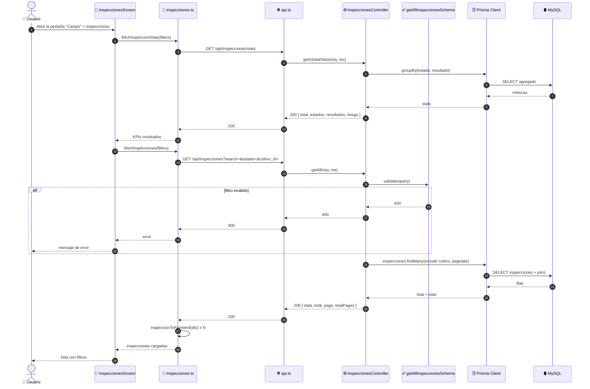
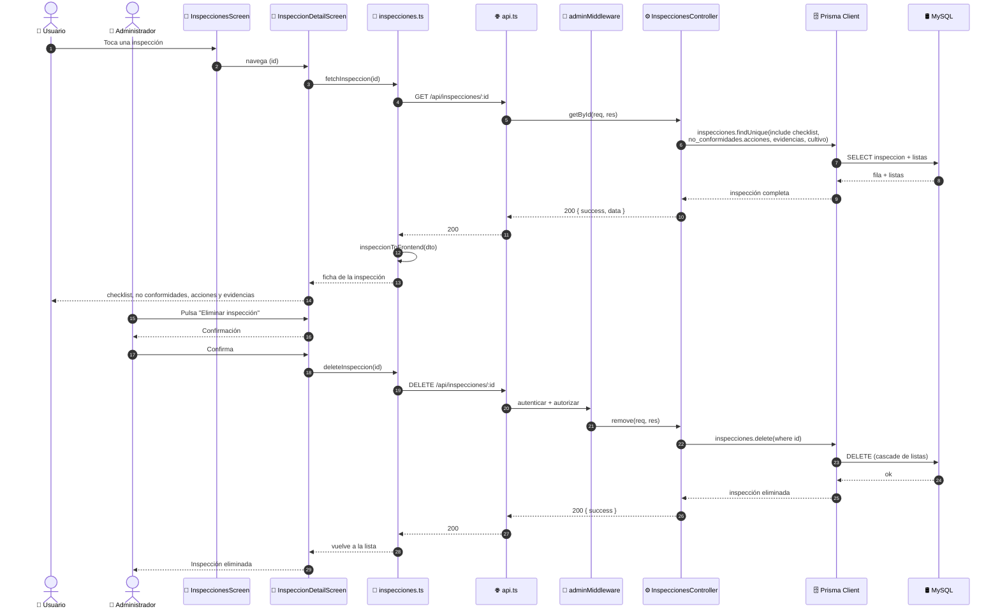

# Diagramas de Secuencia — Inspecciones Internas (SIC) (ICONIX · Parte 4)

> Se derivan del análisis de robustez `03-robustez-gestion-inspecciones.md`.
> Cada objeto boundary/control/entity se convierte en un `participant`.

**Caso de uso cubierto:** UC-16 *Gestionar inspecciones* (16.1 listado, 16.2 detalle,
16.3 alta/edición con checklist, no conformidades y evidencias, 16.4 baja).

---

## 1. Participantes

| `participant` | Rol | Módulo |
|---|---|---|
| `Actor` | 👤 Administrador / Usuario | humano |
| `Pantalla` | 📱 `InspeccionesScreen` / `InspeccionFormScreen` / `InspeccionDetailScreen` | móvil |
| `Opciones` | 📱 `catalogos.ts` (cultivos) | móvil |
| `Servicio` | 📱 `inspecciones.ts` | móvil |
| `Archivos` | 🗂️ `/api/upload/*` | servicio |
| `API` | 🌐 `api.ts` (Axios + interceptor de refresh) | móvil |
| `Middleware` | 🔐 `adminMiddleware` | API |
| `Controlador` | ⚙️ `inspecciones.controller.ts` | API |
| `Validador` | ✅ `inspecciones.validator.ts` (Joi) | API |
| `Listas` | ✅ `ValidarListas` (checklist / NC / evidencias) | API |
| `Prisma` | 🗄️ Prisma Client | API |
| `BD` | 🛢️ MySQL | base de datos |

---

## 2. UC-16.1 · Listado, filtros y estadísticas (solo lectura)



---

## 3. UC-16.3 · Registrar / editar inspección (principal, con las 3 colecciones)

```mermaid
sequenceDiagram
    autonumber
    actor Actor as 👤 Administrador
    participant Pantalla as 📱 InspeccionFormScreen
    participant Opciones as 📱 catalogos.ts
    participant Servicio as 📱 inspecciones.ts
    participant Archivos as 🗂️ /api/upload/*
    participant API as 🌐 api.ts (interceptor)
    participant Middleware as 🔐 adminMiddleware
    participant Controlador as ⚙️ InspeccionesController
    participant Validador as ✅ ValidarInspeccion (Joi)
    participant Listas as ✅ ValidarListas
    participant Prisma as 🗄️ Prisma Client
    participant BD as 🛢️ MySQL

    Actor->>Pantalla: Pulsa "Nueva inspección"
    Pantalla->>Opciones: fetchCultivosOpciones()
    Opciones->>API: GET /api/cultivos?limit=500
    API-->>Opciones: 200 { data }
    Opciones-->>Pantalla: desplegable de cultivos

    Pantalla->>Pantalla: carga catálogos del cliente<br/>(tipos de NC, categorías, criterios)

    Actor->>Pantalla: Captura GPS (latitud/longitud/altitud/precisión)
    Actor->>Pantalla: Completa el checklist (criterios → cumplimiento/riesgo)
    Actor->>Pantalla: Registra no conformidades + acciones correctivas
    Actor->>Pantalla: Adjunta evidencias
    Pantalla->>Archivos: POST /api/upload/* (archivo)
    Archivos-->>Pantalla: 201 { ruta_archivo }

    Actor->>Pantalla: Define resultado, riesgo y resumen. Pulsa "Guardar"
    Pantalla->>Servicio: createInspeccion(datos)
    Servicio->>Servicio: inspeccionToBackend(datos)<br/>serializa checklist + no_conformidades[] + evidencias[]
    Servicio->>API: POST /api/inspecciones (Bearer token)
    API->>Middleware: autenticar + autorizar
    Middleware->>Middleware: Verifica rol = ADMIN

    alt rol ≠ ADMIN
        Middleware-->>API: 403 Acceso denegado
        API-->>Servicio: 403
        Servicio-->>Pantalla: error
        Pantalla-->>Actor: "Acceso denegado"
    end

    Middleware->>Controlador: create(req, res)
    Controlador->>Validador: validate(createInspeccionSchema)
    Validador->>Validador: valida obligatorios y enums

    alt falta cultivo_id, fecha o inspector
        Validador-->>Controlador: 400
        Controlador-->>API: 400
        API-->>Servicio: 400
        Servicio-->>Pantalla: error de validación
        Pantalla-->>Actor: Resalta campos inválidos
    end

    Validador->>Listas: validar(checklist, no_conformidades, evidencias)
    Listas->>Listas: checklist: cada criterio exige 'criterio'<br/>NC: exige tipo, categoria, descripcion, responsable<br/>acción: exige accion, responsable<br/>evidencia: exige nombre

    alt fila de checklist sin 'criterio'
        Listas-->>Validador: 400
        Validador-->>Controlador: 400
        Controlador-->>API: 400
        API-->>Servicio: 400
        Servicio-->>Pantalla: error
        Pantalla-->>Actor: Completa el criterio
    end

    alt no conformidad sin tipo/categoria/descripcion/responsable
        Listas-->>Validador: 400
        Validador-->>Controlador: 400
        Controlador-->>API: 400
        API-->>Servicio: 400
        Servicio-->>Pantalla: error
        Pantalla-->>Actor: Completa la no conformidad
    end

    alt acción correctiva sin accion o responsable
        Listas-->>Validador: 400
        Validador-->>Controlador: 400
        Controlador-->>API: 400
        API-->>Servicio: 400
        Servicio-->>Pantalla: error
        Pantalla-->>Actor: Completa la acción correctiva
    end

    Controlador->>Prisma: inspecciones.create(data + listas anidadas)
    Prisma->>BD: BEGIN TX<br/>INSERT inspecciones<br/>INSERT inspeccion_checklist<br/>INSERT inspeccion_no_conformidades<br/>INSERT inspeccion_acciones_correctivas<br/>INSERT inspeccion_evidencias<br/>COMMIT
    BD-->>Prisma: ids
    Prisma-->>Controlador: Inspección creada con sus listas
    Controlador-->>API: 201 { success, data }
    API-->>Servicio: 201
    Servicio->>Servicio: inspeccionToFrontend(res)
    Servicio-->>Pantalla: inspección persistida
    Pantalla-->>Actor: Vuelve a la lista

    Note over Actor,BD: La edición es idéntica pero con<br/>PUT /api/inspecciones/:id y updateInspeccionSchema<br/>(mínimo 1 campo; las listas enviadas REEMPLAZAN<br/>las existentes)
```

---

## 4. UC-16.2 · Detalle y UC-16.4 · Eliminar inspección



---

## 5. Verificación de robustez (hallazgos)

| # | Hallazgo durante la secuencia | ¿Afecta al caso de uso? | Acción |
|---|---|---|---|
| S-1 | `inspeccionToBackend()` serializa el **árbol completo** (2 niveles de anidamiento) | Sí — complejidad del caso de uso | Reflejado en la secuencia |
| S-2 | `updateInspeccion` usa **`PUT`** y las listas **reemplazan** | Sí — contrato del API | Registrado (R-1, R-3) |
| S-3 | `ValidarListas` valida 4 esquemas anidados (`checklist`, `noConformidad`, `accionCorrectiva`, `evidencia`) | Sí — control separado | Reflejado como participant |
| S-4 | El alta/edición es una **transacción** (inspección + 4 colecciones) | Sí — atomicidad | Mostrado con `BEGIN TX … COMMIT` |
| S-5 | Las **evidencias** se suben vía `POST /api/upload/*` antes de guardar | Sí — actor secundario `Archivos` | Incorporado |
| S-6 | Catálogos de tipos/categorías/criterios **hardcodeados en el cliente** | Deuda R-5 | No modelado como control del API |

> **Verificación ICONIX:** todos los mensajes tienen objeto de robustez asignado. Puede
> avanzarse a la **Parte 5 — Diagrama de Clases**.
