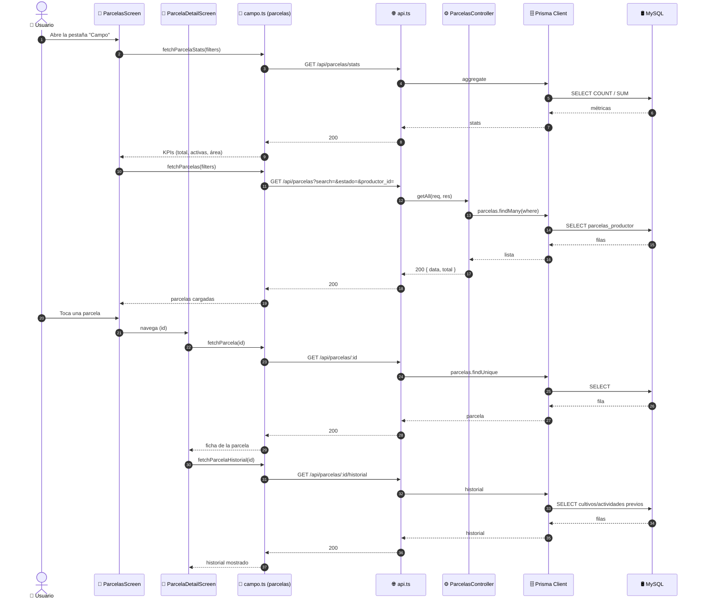

# Diagramas de Secuencia — Gestión de Parcelas (ICONIX · Parte 4)

> **Metodología ICONIX.** Se derivan del análisis de robustez
> `03-robustez-gestion-parcelas.md`: cada objeto boundary/control/entity se convierte en un
> `participant` y el flujo de UC-13 se traduce a mensajes cronológicos.
>
> **Regla:** si aparecen mensajes sin objeto de robustez correspondiente, se vuelve al caso
> de uso (hallazgos al final).

**Caso de uso cubierto:** UC-13 *Gestionar parcelas* (13.1 listado, 13.2 detalle+historial,
13.3 alta/edición con georreferenciación, 13.4 baja, 13.5 documentos y fotos).

---

## 1. Participantes

| `participant` | Rol | Módulo |
|---|---|---|
| `Actor` | 👤 Administrador / Usuario | humano |
| `Pantalla` | 📱 `ParcelasScreen` / `ParcelaFormScreen` / `ParcelaDetailScreen` | móvil |
| `Servicio` | 📱 `campo.ts` (parcelas) | móvil |
| `API` | 🌐 `api.ts` (Axios + interceptor de refresh) | móvil |
| `Middleware` | 🔐 `adminMiddleware` | API |
| `Controlador` | ⚙️ `parcelas.controller.ts` | API |
| `Validador` | ✅ `parcelas.validator.ts` (Joi) | API |
| `Poligono` | ✅ `ValidarPolígono` (custom) | API |
| `Prisma` | 🗄️ Prisma Client | API |
| `BD` | 🛢️ MySQL | base de datos |
| `Archivos` | 🗂️ `/api/upload/*` | servicio |

---

## 2. UC-13.3 · Registrar parcela con georreferenciación (principal)

```mermaid
sequenceDiagram
    autonumber
    actor Actor as 👤 Administrador
    participant Pantalla as 📱 ParcelaFormScreen
    participant Servicio as 📱 campo.ts (parcelas)
    participant API as 🌐 api.ts (interceptor)
    participant Middleware as 🔐 adminMiddleware
    participant Controlador as ⚙️ ParcelasController
    participant Validador as ✅ ValidarParcela (Joi)
    participant Poligono as ✅ ValidarPolígono
    participant Prisma as 🗄️ Prisma Client
    participant BD as 🛢️ MySQL

    Actor->>Pantalla: Abre "Nueva parcela"
    Pantalla->>Servicio: fetchProductoresOpciones()
    Servicio->>API: GET /api/productores
    API->>BD: SELECT productores
    BD-->>API: lista
    API-->>Servicio: 200 { data }
    Servicio-->>Pantalla: desplegable de productores

    Pantalla->>Servicio: fetchDepartamentos() / fetchCatalogo(tipo)
    Servicio->>API: GET /api/ubigeo/departamentos
    API-->>Servicio: 200 { data }
    Servicio-->>Pantalla: desplegables (suelo, agua, riego, zona)

    Actor->>Pantalla: Captura GPS y dibuja polígono
    Pantalla->>Pantalla: calcula área/perímetro

    Actor->>Pantalla: Completa datos y pulsa "Guardar"
    Pantalla->>Servicio: createParcela(datos)
    Servicio->>API: POST /api/parcelas (parcelaToBackend, Bearer token)
    API->>Middleware: autenticar + autorizar
    Middleware->>Middleware: Verifica rol = ADMIN

    alt rol ≠ ADMIN
        Middleware-->>API: 403 Acceso denegado
        API-->>Servicio: 403
        Servicio-->>Pantalla: error
        Pantalla-->>Actor: "Acceso denegado"
    end

    Middleware->>Controlador: create(req, res)
    Controlador->>Validador: validate(createParcelaSchema)
    Validador->>Poligono: validar(poligono)

    alt polígono con < 3 vértices
        Poligono-->>Validador: 400 "El polígono debe tener al menos 3 vértices"
        Validador-->>Controlador: 400
        Controlador-->>API: 400
        API-->>Servicio: 400
        Servicio-->>Pantalla: error
        Pantalla-->>Actor: Resalta el polígono inválido
    end

    alt vértice duplicado o coordenada fuera de rango
        Poligono-->>Validador: 400 (con índice del vértice)
        Validador-->>Controlador: 400
        Controlador-->>API: 400
        API-->>Servicio: 400
        Servicio-->>Pantalla: error
        Pantalla-->>Actor: Indica el vértice erróneo
    end

    alt datos obligatorios faltantes
        Validador-->>Controlador: 400 (detalle por campo)
        Controlador-->>API: 400
        API-->>Servicio: 400
        Servicio-->>Pantalla: error de validación
        Pantalla-->>Actor: Resalta campos inválidos
    end

    Controlador->>Prisma: parcelas.create(data)
    Prisma->>BD: INSERT INTO parcelas_productor
    BD-->>Prisma: id + codigo generado
    Prisma-->>Controlador: Parcela creada
    Controlador-->>API: 201 { success, data }
    API-->>Servicio: 201
    Servicio-->>Pantalla: parcela persistida
    Pantalla-->>Actor: Vuelve a la lista con la nueva parcela
```

---

## 3. UC-13.1 / UC-13.2 · Listado, detalle e historial (solo lectura)



---

## 4. UC-13.5 · Adjuntar documento y foto

```mermaid
sequenceDiagram
    autonumber
    actor Actor as 👤 Administrador
    participant Detalle as 📱 ParcelaDetailScreen
    participant Servicio as 📱 campo.ts (parcelas)
    participant Upload as 🗂️ /api/upload/*
    participant API as 🌐 api.ts
    participant Middleware as 🔐 adminMiddleware
    participant Controlador as ⚙️ ParcelasController
    participant Validador as ✅ ValidarDocumento / ValidarFoto
    participant Prisma as 🗄️ Prisma Client
    participant BD as 🛢️ MySQL

    Actor->>Detalle: Pulsa "Adjuntar foto"
    Detalle->>Upload: POST /api/upload/fotos (archivo)
    Upload->>BD: almacena el archivo
    BD-->>Upload: ruta_archivo
    Upload-->>Detalle: 201 { ruta_archivo }

    Detalle->>Servicio: createParcelaFoto(parcelaId, foto)
    Servicio->>API: POST /api/parcelas/:id/fotos
    API->>Middleware: autenticar + autorizar
    Middleware->>Controlador: createFoto(req, res)
    Controlador->>Validador: validate(createParcelaFotoSchema)

    alt titulo ausente
        Validador-->>Controlador: 400
        Controlador-->>API: 400
        API-->>Servicio: 400
        Servicio-->>Detalle: error
        Detalle-->>Actor: "El título es obligatorio"
    end

    Controlador->>Prisma: parcelasFotos.create(data)
    Prisma->>BD: INSERT INTO fotos_parcela
    BD-->>Prisma: id
    Prisma-->>Controlador: foto creada
    Controlador-->>API: 201 { success, data }
    API-->>Servicio: 201
    Servicio-->>Detalle: foto adjunta
    Detalle-->>Actor: galería actualizada

    Note over Actor,Detalle: El flujo de documentos es idéntico,<br/>usando ValidarDocumento y la tabla documentos_parcela
```

---

## 5. UC-13.4 · Eliminar parcela

```mermaid
sequenceDiagram
    autonumber
    actor Actor as 👤 Administrador
    participant Detalle as 📱 ParcelaDetailScreen
    participant Servicio as 📱 campo.ts (parcelas)
    participant API as 🌐 api.ts
    participant Middleware as 🔐 adminMiddleware
    participant Controlador as ⚙️ ParcelasController
    participant Prisma as 🗄️ Prisma Client
    participant BD as 🛢️ MySQL

    Actor->>Detalle: Pulsa "Eliminar parcela"
    Detalle-->>Actor: Confirmación
    Actor->>Detalle: Confirma
    Detalle->>Servicio: deleteParcela(id)
    Servicio->>API: DELETE /api/parcelas/:id
    API->>Middleware: autenticar + autorizar
    Middleware->>Controlador: remove(req, res)
    Controlador->>Prisma: parcelas.delete(where id)
    Prisma->>BD: DELETE (o soft-delete)
    BD-->>Prisma: ok
    Prisma-->>Controlador: parcela eliminada
    Controlador-->>API: 200 { success }
    API-->>Servicio: 200
    Servicio-->>Detalle: vuelve a la lista
    Detalle-->>Actor: Parcela eliminada
```

---

## 6. Verificación de robustez (hallazgos)

| # | Hallazgo durante la secuencia | ¿Afecta al caso de uso? | Acción |
|---|---|---|---|
| S-1 | Existe `parcelaToBackend()` (mapeo camelCase→snake_case) | Sí — no era explícito en el flujo | Añadido; relevante para Parte 5 |
| S-2 | La **captura GPS y el dibujo del polígono** ocurren en el cliente, pero la **validación** es en el API | Sí — separa frontera de control | Reflejado en el flujo |
| S-3 | `createParcelaDocumento`/`createParcelaFoto` son dos casos de uso derivados de UC-13.5 | Sí — flujo aparte | Documentado (§4) |
| S-4 | `updateParcela` usa **`PUT`** (no `PATCH`), distinto de campañas (`PATCH`) | Sí — contrato del API | Registrado |
| S-5 | La **carga de desplegables** (productores, ubigeo, catálogos) precede al alta | Sí — control de apoyo | Incorporado |

> **Verificación ICONIX:** todos los mensajes tienen objeto de robustez asignado. Puede
> avanzarse a la **Parte 5 — Diagrama de Clases** para este caso de uso.
