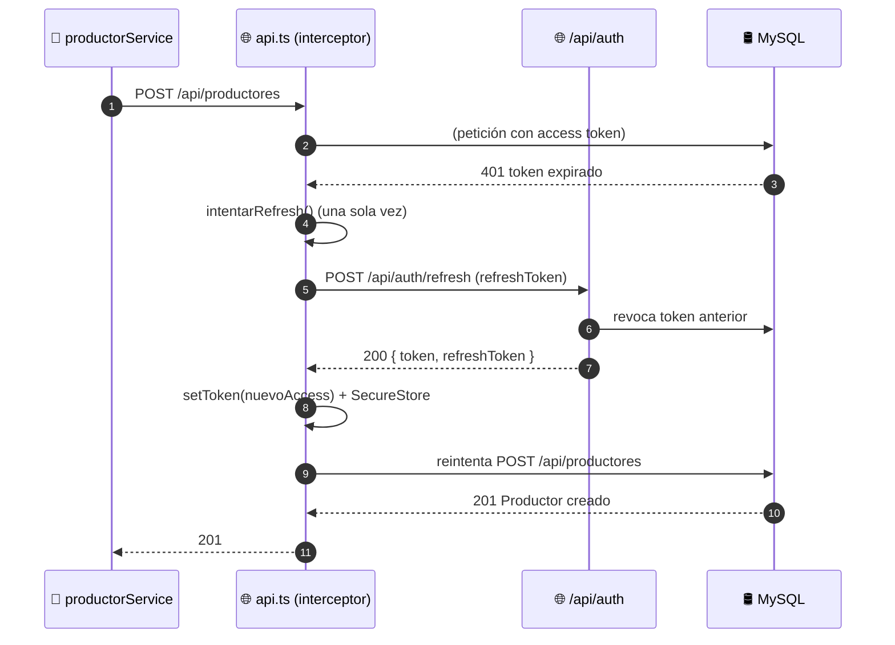

# Diagramas de Secuencia — Registro de Productores y sus Familiares (ICONIX · Parte 4)

> **Metodología ICONIX — Diagramas de Secuencia.** Se derivan del **análisis de robustez**
> (Parte 3): cada objeto boundary/control/entity se convierte en un `participant`, y el flujo
> del caso de uso se traduce a mensajes en orden cronológico.
>
> **Regla ICONIX:** si al dibujar la secuencia aparecen mensajes que no encajan con ningún
> objeto de robustez, hay que volver atrás y corregir el caso de uso (se documentan los
> hallazgos al final del archivo).
>
> **Nota Mermaid:** no existe tipo nativo de diagrama de secuencia UML "clasico"; se emula con
> `sequenceDiagram` (participantes + flechas + fragmentos `alt`/`opt`).

**Caso de uso cubierto:** UC-08 *Registrar productor* + UC-11.2 *Registrar familiar* (extendido).

---

## 1. Contexto de participantes

| `participant` | Rol | Módulo |
|---|---|---|
| `Actor` | 👤 Administrador | humano |
| `Pantalla` | 📱 Formulario Productor (`ProductorCreateScreen`) | móvil |
| `Servicio` | 📱 `productorService` (`apps/mobile/src/services/productores.ts`) | móvil |
| `API` | 🌐 `api.ts` (cliente Axios + interceptor de refresh) | móvil |
| `Middleware` | 🔐 `adminMiddleware` | API |
| `Controlador` | ⚙️ `productores.controller.ts` | API |
| `Validador` | ✅ `productores.validator.ts` (Joi) | API |
| `Prisma` | 🗄️ Prisma Client | API |
| `BD` | 🛢️ MySQL | base de datos |

---

## 2. UC-08 · Registrar productor (flujo normal + excepciones)

```mermaid
sequenceDiagram
    autonumber
    actor Actor as 👤 Administrador
    participant Pantalla as 📱 ProductorCreateScreen
    participant Servicio as 📱 productorService
    participant API as 🌐 api.ts (interceptor)
    participant Middleware as 🔐 adminMiddleware
    participant Controlador as ⚙️ ProductoresController
    participant Validador as ✅ ValidarProductor (Joi)
    participant Prisma as 🗄️ Prisma Client
    participant BD as 🛢️ MySQL

    Actor->>Pantalla: Abre "Nuevo productor"
    Pantalla->>Servicio: fetchDepartamentos() / fetchCatalogo(tipo)
    Servicio->>API: GET /api/ubigeo/departamentos
    API->>BD: SELECT ubigeo
    BD-->>API: departamentos
    API-->>Servicio: 200 { data }
    Servicio-->>Pantalla: desplegables poblados

    Actor->>Pantalla: Completa datos y pulsa "Guardar"
    Pantalla->>Servicio: createProductor(datos)
    Servicio->>API: POST /api/productores (Bearer token)
    API->>Middleware: autenticar + autorizar
    Middleware->>Middleware: Verifica rol = ADMIN

    alt rol ≠ ADMIN
        Middleware-->>API: 403 Acceso denegado
        API-->>Servicio: 403
        Servicio-->>Pantalla: error
        Pantalla-->>Actor: Muestra "Acceso denegado"
    end

    Middleware->>Controlador: create(req, res)
    Controlador->>Validador: validate(createProductorSchema)
    Validador->>Validador: Aplica RN-1…RN-9

    alt datos inválidos
        Validador-->>Controlador: 400 (detalle por campo)
        Controlador-->>API: 400
        API-->>Servicio: 400
        Servicio-->>Pantalla: error de validación
        Pantalla-->>Actor: Resalta campos inválidos
    end

    Controlador->>Prisma: productores.create(data)
    Prisma->>BD: INSERT INTO productores
    BD-->>Prisma: id + codigo generado

    alt DNI duplicado
        Prisma-->>Controlador: UniqueConstraintError
        Controlador-->>API: 409 DNI ya registrado
        API-->>Servicio: 409
        Servicio-->>Pantalla: error
        Pantalla-->>Actor: "El DNI ya está registrado"
    end

    Prisma-->>Controlador: Productor creado
    Controlador-->>API: 201 { success, data }
    API-->>Servicio: 201
    Servicio-->>Pantalla: Productor persistido
    Pantalla-->>Actor: Vuelve a la lista con el nuevo registro
```

---

## 3. UC-11.2 · Registrar familiar (extendido desde el detalle)

```mermaid
sequenceDiagram
    autonumber
    actor Actor as 👤 Administrador
    participant Detalle as 📱 ProductorDetailScreen
    participant Familiares as 📱 FamiliaresScreen
    participant Formulario as 📱 FamiliarCreateScreen
    participant Servicio as 📱 productorService
    participant API as 🌐 api.ts
    participant Middleware as 🔐 adminMiddleware
    participant Controlador as ⚙️ ProductoresController
    participant Validador as ✅ ValidarFamiliar (Joi)
    participant Prisma as 🗄️ Prisma Client
    participant BD as 🛢️ MySQL

    Actor->>Detalle: Pulsa "Ver familiares"
    Detalle->>Servicio: fetchFamiliares(productorId)
    Servicio->>API: GET /api/productores/:id/familiares
    API->>Prisma: familiares.findMany(where productor_id)
    Prisma->>BD: SELECT familiares_productor
    BD-->>Prisma: filas
    Prisma-->>API: lista
    API-->>Servicio: 200 { data }
    Servicio-->>Familiares: familiares cargados

    Actor->>Familiares: Pulsa "Nuevo familiar"
    Familiares->>Formulario: abre formulario
    Actor->>Formulario: Completa datos y pulsa "Guardar"
    Formulario->>Servicio: createFamiliar(productorId, datos)
    Servicio->>API: POST /api/productores/:id/familiares
    API->>Middleware: autenticar + autorizar
    Middleware->>Controlador: createFamiliar(req, res)
    Controlador->>Validador: validate(createFamiliarSchema)
    Validador->>Validador: Aplica RN-1…RN-4

    alt datos inválidos
        Validador-->>Controlador: 400
        Controlador-->>API: 400
        API-->>Servicio: 400
        Servicio-->>Formulario: error
        Formulario-->>Actor: Resalta campos inválidos
    end

    Controlador->>Prisma: familiares.create(data)
    Prisma->>BD: INSERT INTO familiares_productor
    BD-->>Prisma: id
    Prisma-->>Controlador: Familiar creado
    Controlador-->>API: 201 { success, data }
    API-->>Servicio: 201
    Servicio-->>Familiares: familiar agregado
    Familiares-->>Actor: Lista actualizada
```

---

## 4. Transversal · Renovación automática del token (UC-02)

Fragmento que puede intercalar en cualquier petición de las anteriores.



---

## 5. Verificación de robustez (hallazgos)

| # | Hallazgo durante la secuencia | ¿Afecta al caso de uso? | Acción |
|---|---|---|---|
| S-1 | La carga de **ubigeo/catálogos** aparece como paso previo del formulario | Sí — antes no figuraba | Incorporado en la robustez (Parte 3) |
| S-2 | El **interceptor de refresh** (UC-02) se cruza con cualquier petición | Sí — transversal | Documentado como fragmento independiente (§4) |
| S-3 | `productorService` transforma a `snake_case` (`toBackend`) antes de enviar | Sí — no era explícito en el flujo | Se añade al flujo; relevante para la parte 5 (clases) |
| S-4 | La respuesta del API **genera el `codigo`** del productor si no se envía | Alternativa A1 de UC-08 | Confirmada en la secuencia |

> Con S-1..S-4 la secuencia valida la robustez: **no hay mensajes huérfanos** que obliguen a
> redefinir el caso de uso. ICONIX permite avanzar a la Parte 5 (Diagrama de Clases).

---

**Estado:** primer diagrama de secuencia (registro de productores y familiares) + fragmento
transversal de token. Continúan los secuencias de Campo, Calidad y Operaciones.
