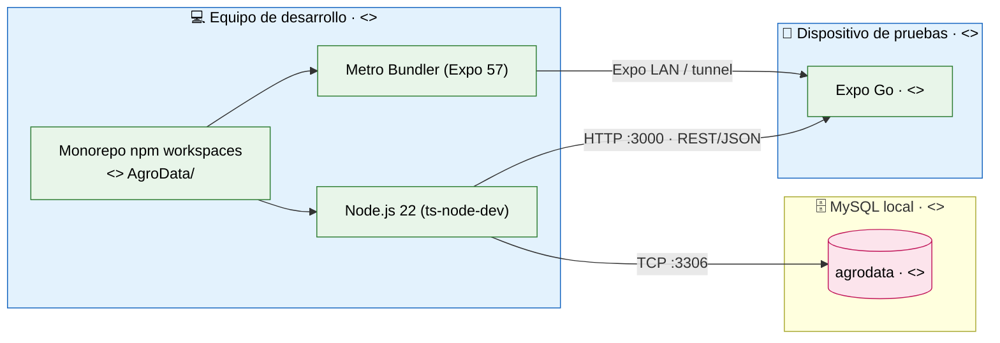

# Diagrama de Despliegue — Aplicación Móvil (Anexo UML)

> **Alcance:** diagrama de despliegue UML del sistema, enfocado en la **aplicación móvil**
> (`apps/mobile`) y su entorno de ejecución. Mermaid no tiene tipo nativo de *deployment
> diagram*; se emula con `flowchart` (nodos = subgrafos con estereotipo `<<device>>`,
> `<<executionEnvironment>>`, `<<node>>`; artefactos = nodos internos).
>
> **Stack verificado** en `package.json`:
> - **Móvil:** Expo ~57.0.30 · React Native 0.86.3 · React 19.2.3 · React Navigation 7 ·
>   TanStack Query 5 · Axios · `expo-secure-store` · `expo-location` · `react-native-svg`.
> - **API:** Node.js 22 · Express 4.21.2 · Prisma 6.10.1 · bcrypt · jsonwebtoken ·
>   Joi · Helmet · CORS · Morgan · Multer 2.2 · Turf.js.
> - **BD:** MySQL.

**Contenido**
1. [Despliegue en producción](#1-despliegue-en-producción)
2. [Despliegue en desarrollo](#2-despliegue-en-desarrollo)
3. [Nodos y artefactos](#3-nodos-y-artefactos)
4. [Protocolos y canales de comunicación](#4-protocolos-y-canales-de-comunicación)
5. [Requisitos del entorno](#5-requisitos-del-entorno)

---

## 1. Despliegue en producción

```mermaid
flowchart TB
    %% ══════════════ NODO: DISPOSITIVO MÓVIL ══════════════
    subgraph MOVIL["📱 Dispositivo Móvil · <<device>> · Android / iOS"]
        direction TB
        M_APP["AgroDataApp.apk / .ipa · <<artifact>>"]
        M_RUNTIME["Hermes / JS Engine · <<executionEnvironment>>"]
        M_NAV["React Navigation 7 (tabs + stacks)"]
        M_QUERY["TanStack Query 5 (caché de datos)"]
        M_HTTP["Axios + interceptor api.ts"]
        M_TOKEN[["expo-secure-store<br/>refresh token (cifrado)"]]
        M_STORE[["AsyncStorage<br/>usuario + preferencias"]]
        M_GPS["expo-location · GPS"]
        M_CAM["Cámara / galería"]
        M_SVG["react-native-svg (gráficos)"]
    end

    %% ══════════════ NODO: SERVIDOR DE APLICACIÓN ══════════════
    subgraph SRV_API["🖥️ Servidor de Aplicación · <<executionEnvironment>> · Node.js 22"]
        direction TB
        A_APP["api.js · <<artifact>> Express 4.21 + TypeScript"]
        A_SEC["Helmet · CORS · Morgan · rate-limit"]
        A_AUTH["JWT + bcrypt (auth.middleware)"]
        A_VALID["Joi (validators)"]
        A_UPLOAD["Multer 2.2 (uploads)"]
        A_PRISMA["Prisma Client 6.10"]
    end

    %% ══════════════ NODO: BASE DE DATOS ══════════════
    subgraph SRV_DB["🗄️ Servidor de Base de Datos · <<executionEnvironment>> · MySQL 8"]
        D_DB[("agrodata · <<artifact>><br/>schema.prisma + migraciones<br/>30 tablas")]
    end

    %% ══════════════ NODO: ALMACENAMIENTO ══════════════
    subgraph SRV_FILES["📁 Almacenamiento de Archivos · <<node>>"]
        F_DIR[["uploads/ · <<artifact>><br/>documentos · fotos · firmas"]]
    end

    %% ══════════════ CANALES ══════════════
    M_HTTP -->|"HTTPS :443 · REST/JSON<br/>Authorization: Bearer JWT"| A_SEC
    A_APP --> A_SEC
    A_SEC --> A_AUTH
    A_AUTH --> A_VALID
    A_VALID --> A_PRISMA
    A_PRISMA -->|"TCP :3306 · Prisma"| D_DB
    A_UPLOAD -->|"Filesystem I/O"| F_DIR

    %% Comunicación interna del móvil
    M_APP --> M_RUNTIME
    M_APP --> M_NAV
    M_APP --> M_QUERY
    M_QUERY --> M_HTTP
    M_HTTP --> M_TOKEN
    M_APP --> M_STORE
    M_GPS --> M_APP
    M_CAM --> M_APP

    %% ══════════════ ESTILOS ══════════════
    classDef device     fill:#e3f2fd,stroke:#1565c0,color:#000;
    classDef runtime    fill:#f3e5f5,stroke:#6a1b9a,color:#000;
    classDef artifact   fill:#e8f5e9,stroke:#2e7d32,color:#000;
    classDef storage    fill:#fff3e0,stroke:#ef6c00,color:#000;
    classDef db         fill:#fce4ec,stroke:#c2185b,color:#000;

    class M_APP artifact
    class M_RUNTIME,M_NAV,M_QUERY,M_HTTP,M_GPS,M_CAM,M_SVG runtime
    class M_TOKEN,M_STORE storage
    class A_APP,A_SEC,A_AUTH,A_VALID,A_UPLOAD,A_PRISMA artifact
    class D_DB db
    class F_DIR storage
```

---

## 2. Despliegue en desarrollo

En desarrollo el móvil corre sobre **Expo Go / Metro Bundler** y se comunica por HTTP
local con el API; los secretos se cargan desde `.env`.

---

## 3. Nodos y artefactos

| Nodo | Estereotipo | Artefactos desplegados | Tecnología |
|---|---|---|---|
| **Dispositivo Móvil** | `<<device>>` | `AgroDataApp.apk/.ipa`, SecureStore, AsyncStorage | Expo 57 · RN 0.86 · React 19.2 |
| **Runtime JS (móvil)** | `<<executionEnvironment>>` | Hermes engine, React Navigation 7, TanStack Query 5, Axios | — |
| **Servidor de Aplicación** | `<<executionEnvironment>>` | `api.js` (rutas, middleware, controllers, validators, Prisma Client) | Node.js 22 · Express 4.21 · TS |
| **Servidor de Base de Datos** | `<<executionEnvironment>>` | `agrodata` (schema + migraciones) | MySQL 8 · Prisma 6.10 |
| **Almacenamiento de archivos** | `<<node>>` | `uploads/` (documentos, fotos, firmas) | Filesystem del servidor |
| **Equipo de desarrollo** *(solo dev)* | `<<device>>` | Monorepo `AgroData/`, Metro Bundler, `ts-node-dev` | Node.js 22 |
| **Dispositivo de pruebas** *(solo dev)* | `<<device>>` | `Expo Go` | Expo Go |

### Artefactos y su localización en el repo

| Artefacto | Origen | Salida desplegable |
|---|---|---|
| App móvil | `apps/mobile/` | `AgroDataApp.apk` (Android) / `.ipa` (iOS) vía `expo start --android/--ios` |
| API REST | `apps/api/src/` | `apps/api/dist/server.js` (`npm run build`) |
| Esquema BD | `packages/database/prisma/schema.prisma` | Migraciones + `prisma generate` |
| Tipos compartidos | `packages/types/` | Paquete `@agrodata/types` (consumido por móvil y API) |

---

## 4. Protocolos y canales de comunicación

| # | Origen → Destino | Protocolo / Formato | Seguridad | Uso |
|---|---|---|---|---|
| 1 | Móvil → API | **HTTPS** · REST · JSON | `Authorization: Bearer <JWT>` + refresh token rotativo | Todas las operaciones |
| 2 | API → MySQL | **TCP :3306** · Prisma | Credenciales en `DATABASE_URL` | Persistencia |
| 3 | API → `uploads/` | Filesystem I/O | `Multer` (mime/size) | Documentos, fotos, firmas |
| 4 | Móvil → SecureStore | Local (cifrado por el SO) | — | Refresh token |
| 5 | Móvil → AsyncStorage | Local | — | Usuario y preferencias |
| 6 | GPS / Cámara → Móvil | Sensores locales | — | Georreferenciación, evidencias |
| 7 | Móvil → API *(dev)* | HTTP :3000 | `FRONTEND_URL` en CORS | Desarrollo local |

### Cabeceras y seguridad en el canal 1

| Elemento | Valor / Detalle |
|---|---|
| `Authorization` | `Bearer <access_token>` (JWT HS256, `issuer=agrodata-api`) |
| Rotación | `POST /api/auth/refresh` invoca el refresh token y **revoca el anterior** |
| Rate limit | 300 req/min globales (`/api`); login 10/15 min; resto auth 20/15 min |
| CORS | `FRONTEND_URL` + `FRONTEND_URLS` (configurables) |
| Headers | `Helmet` (seguros) |

---

## 5. Requisitos del entorno

| Recurso | Desarrollo | Producción |
|---|---|---|
| **Móvil** | Expo Go instalado / emulador Android o iOS | APK/IPA instalado en el dispositivo |
| **Node.js** | ≥ 22 | ≥ 22 |
| **MySQL** | Local (puerto 3306) | Instancia gestionada o dedicada |
| **Puerto API** | 3000 (`apps/api/.env` `PORT`) | 443 (detrás de proxy HTTPS) |
| **Variables** | `apps/api/.env` · `packages/database/.env` | Mismas + `NODE_ENV=production` |
| **Almacenamiento** | `apps/api/uploads/` | Volumen persistente (backup) |
| **Acceso móvil** | LAN / tunnel de Expo | Internet (dominio + TLS) |

---

> **Relación con ICONIX:** este diagrama complementa la **Parte 5 (Clases)** mostrando **dónde
> se despliegan** los artefactos que implementan esas clases. La Parte 6 (Matriz de
> Trazabilidad) relaciona casos de uso ↔ clases ↔ pantallas.
