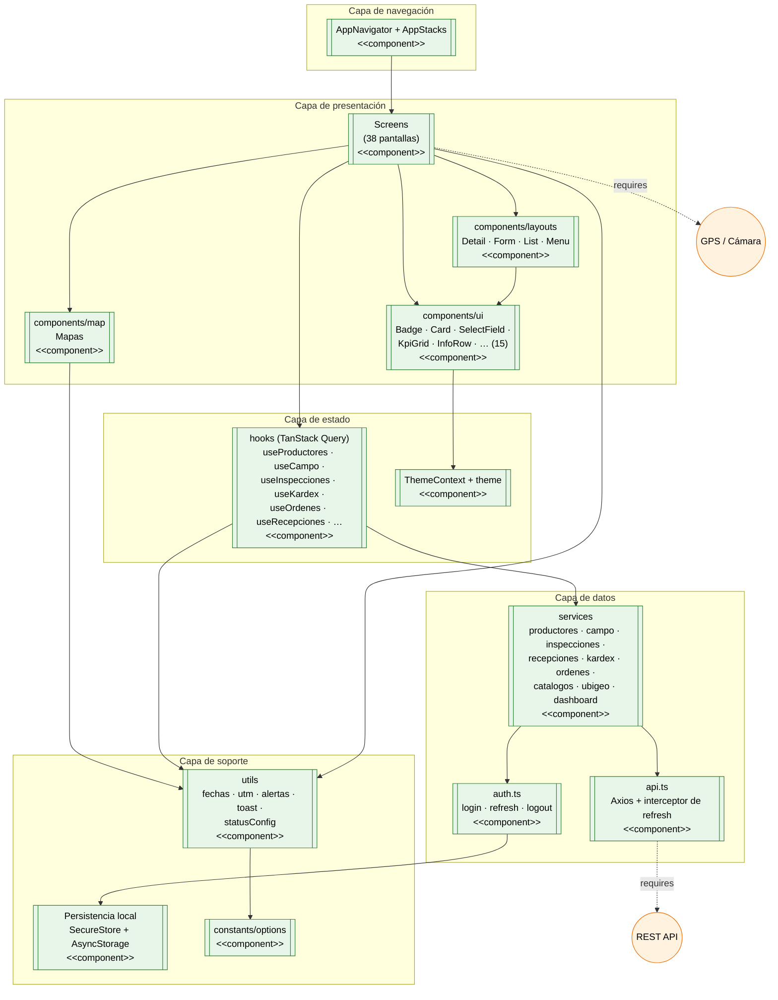
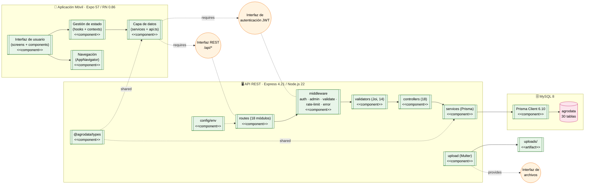

# Diagrama de Componentes — Aplicación Móvil (Anexo UML)

> **Alcance:** diagrama de componentes UML de la aplicación móvil (`apps/mobile`) y su
> relación con los componentes del API (`apps/api`).
>
> **Notación Mermaid:** se emula el componente UML con `[[texto]]` (forma de subrutina,
> visualmente equivalente al símbolo de componente) y las **interfaces** con `((o))`
> (círculo = *provided*; círculo con unión discontinua = *required*).
>
> **Estructura verificada** en `apps/mobile/src/` y `apps/api/src/`:
> móvil → `components/{ui,layouts,map}`, `constants`, `contexts`, `hooks`, `navigation`,
> `screens`, `services`, `theme`, `utils`. API → `config`, `controllers`, `middleware`,
> `routes`, `services`, `types`, `validators`, `__tests__`.

**Contenido**
1. [Componentes de la aplicación móvil](#1-componentes-de-la-aplicación-móvil)
2. [Componentes del sistema completo](#2-componentes-del-sistema-completo)
3. [Catálogo de componentes](#3-catálogo-de-componentes)
4. [Interfaces y contratos](#4-interfaces-y-contratos)

---

## 1. Componentes de la aplicación móvil

Vista interna: capas del móvil y dependencias entre sus componentes.

---

## 2. Componentes del sistema completo

Vista de alto nivel: móvil ↔ API ↔ base de datos, con las interfaces que cada uno
**provee** (círculo) y **requiere**.

---

## 3. Catálogo de componentes

### 3.1 Aplicación móvil (`apps/mobile/src/`)

| Componente | Archivos / contenido | Responsabilidad |
|---|---|---|
| **Screens** | 38 pantallas (`screens/`) | Interfaces de usuario por módulo |
| **components/layouts** | `DetailScreenLayout`, `FormScreenLayout`, `ListScreenLayout`, `MenuScreenLayout` | Plantillas reutilizables de pantalla |
| **components/ui** | `Badge`, `Card`, `ConfirmDialog`, `CustomHeader`, `DatePickerField`, `EmptyState`, `HeaderUsuario`, `InfoRow`, `KpiGrid`, `LoadingSpinner`, `PageHeader`, `SearchInput`, `SectionHeader`, `SelectField`, `UbigeoSelect` (15) | Controles visuales base |
| **components/map** | `Mapas` | Visualización geográfica (parcelas, actividades) |
| **navigation** | `AppNavigator`, `AppStacks`, `types` | Árbol de navegación (tabs + stacks) |
| **hooks** | `useProductores`, `useCampo`, `useActividades`, `useInspecciones`, `useRecepciones`, `useKardex`, `useOrdenes`, `useDashboard`, `useUbigeo`, `useUsuarioActual`, `useLogout`, `useDebounce`, `acumularLista` | Consultas y mutaciones (TanStack Query) |
| **services** | `api`, `auth`, `productores`, `campo`, `actividades`, `inspecciones`, `recepciones`, `kardex`, `ordenes`, `catalogos`, `ubigeo`, `dashboard`, `index` | Acceso al API + transformación `*ToBackend`/`*ToFrontend` |
| **contexts** | `ThemeContext` | Tema visual global |
| **theme** | `index`, `tokens` | Tokens de diseño |
| **constants** | `options` | Opciones de formularios |
| **utils** | `fechas`, `utm`, `alertas`, `toast`, `statusConfig` | Utilidades transversales |

### 3.2 API REST (`apps/api/src/`)

| Componente | Contenido | Responsabilidad |
|---|---|---|
| **routes** | 18 archivos (`*.routes.ts`) | Definición de endpoints y `adminMiddleware` |
| **middleware** | `auth.middleware`, `validate.middleware` (+ error handler) | Autenticación, autorización, validación, rate limit |
| **controllers** | 18 controladores | Lógica de orquestación por módulo |
| **services** | Servicios Prisma | Acceso a datos |
| **validators** | 14 esquemas Joi | Reglas de negocio e invariantes |
| **config** | `env.ts` | Variables de entorno tipadas |
| **types** | `usuarios.types`, etc. | Tipos compartidos |
| **__tests__** | Pruebas | Verificación |

### 3.3 Paquete compartido

| Componente | Contenido | Consumido por |
|---|---|---|
| `@agrodata/types` | Tipos TS compartidos | Móvil y API |

---

## 4. Interfaces y contratos

| Interfaz | Tipo | Proveedor | Requerido por | Contrato |
|---|---|---|---|---|
| **Interfaz REST** `/api/*` | *provided* por API | `routes` | `services` del móvil | JSON sobre HTTPS; 18 módulos |
| **Interfaz de autenticación** | *provided* por API | `auth.middleware` | `api.ts` (interceptor) | JWT Bearer + refresh rotativo |
| **Interfaz de archivos** | *provided* por API | `upload` (Multer) | Formularios (fotos, firmas) | `multipart/form-data` |
| **Persistencia local** | *provided* por SO | `expo-secure-store`, `AsyncStorage` | `auth.ts` | Almacenamiento seguro/opaco |
| **GPS / Cámara** | *provided* por hardware | `expo-location`, Cámara | Parcelas, actividades, inspecciones | Coordenadas + archivos |
| **`@agrodata/types`** | *shared* | `packages/types` | Móvil y API | Contrato de tipos TS |

### Dependencias clave observadas

- `Screens` **no** hablan directamente con el API: pasan por `hooks` → `services` → `api.ts`
  (**excepción**: las pantallas de **Acopios** llaman `api.*` directamente, deuda R-1).
- `services` es el **único** componente con conocimiento del mapeo `snake_case ↔ camelCase`.
- `auth.ts` encapsula el ciclo de vida del token (login, refresh, logout) y es consumido por
  el interceptor de `api.ts`.
- `@agrodata/types` garantiza el **contrato compartido** entre móvil y API (patrón
  "contrato primero").

---

> **Relación con ICONIX:** este diagrama muestra **cómo se organizan** los componentes que
> implementan las clases (Parte 5) y que ejecutan los casos de uso (Parte 2). La Parte 6
> (Matriz de Trazabilidad) cierra la cadena.
