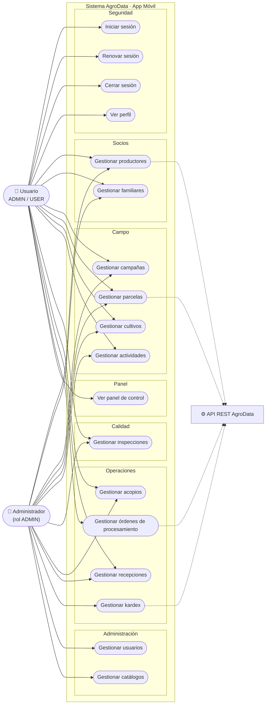
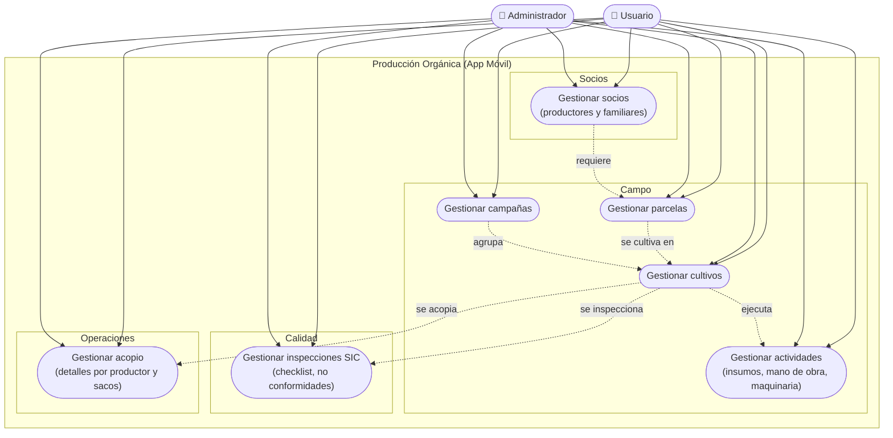
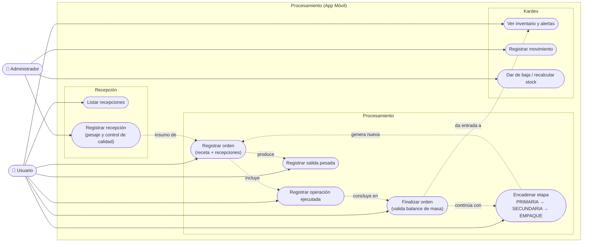
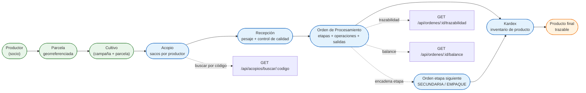

# Diagramas de Casos de Uso — AgroData Móvil

> Gráficos Mermaid para la tesis. Se renderizan en `https://mermaid.live` (pegar el bloque)
> o en cualquier editor Markdown compatible (VS Code + extensión Mermaid, GitHub, Obsidian).
>
> **Nota de notación:** Mermaid no tiene un tipo nativo de *diagrama de casos de uso* UML; se
> emula con `flowchart` (actores = rectángulos; casos de uso = elipses/stadium; frontera del
> sistema = subgrafo). Es equivalente UML 2 y suficiente para la tesis.

Contenido:
1. [Caso de uso general](#1-caso-de-uso-general)
2. [Caso de uso de Producción Orgánica](#2-caso-de-uso-de-producción-orgánica)
3. [Caso de uso de Procesamiento](#3-caso-de-uso-de-procesamiento)
4. [Flujo de Trazabilidad](#4-flujo-de-trazabilidad)

---

## 1. Caso de uso general

Vista global de todos los módulos del sistema móvil y sus actores.

---

## 2. Caso de uso de Producción Orgánica

Cubre la cadena de producción: **socios → parcelas → campañas → cultivos → actividades →
inspecciones → acopio**. Los actores primarios son el Usuario (lectura) y el Administrador
(escritura). Se marca con flechas punteadas la dependencia secuencial entre casos de uso.

---

## 3. Caso de uso de Procesamiento

Cubre la transformación: **recepción → procesamiento (órdenes, recetas, operaciones, salidas)
→ kardex (inventario)**. La orden puede encadenarse entre etapas (PRIMARIA → SECUNDARIA →
EMPAQUE) y al finalizar da entrada al Kardex.

---

## 4. Flujo de Trazabilidad

Cadena de trazabilidad del producto, desde el **productor** hasta el **producto final**,
pasando por los eslabones que el sistema registra. Cada nodo indica el recurso/API donde se
recupera la información.

> **Lectura del diagrama:** la cadena `Productor → Parcela → Cultivo` representa el origen
> agrícola; `Acopio → Recepción → Procesamiento → Kardex` representa la transformación y el
> inventario; los nodos punteados muestran los puntos de consulta de trazabilidad expuestos
> por el API (`/trazabilidad`, `/balance`, `/buscar/:codigo`).
